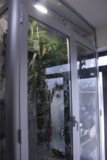
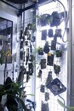
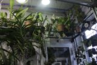

Ad un anno circa (fine 2012) dalla messa in opera dell' “orchirama” (a tal proposito si veda più sotto “Un orchirama in casa”), Giovanni trae le prime conclusioni utili per raffinare la sua esperienza di coltivazione e godimento domestico.

Di seguito il suo resoconto “annuale”.

La serra funziona bene, ho constatato però che dovrò aumentare l'estrazione di aria mediante un aspiratore più potente per dare un maggior ricambio.

Ho riscontrato purtroppo un “buon” proliferare di cocciniglia cotonosa.

Ho monitorato le temperature nelle varie parti della serra: la parte bassa resta sui 19/20 gradi, quella intermedia sui 23/24 e la parte alta si assesta sui 26 gradi con un'umidità diurna al 60/65%...

Le piante rispondono bene con vegetazioni e fioriture adeguate alla situazione, per il resto quindi... tutto ok!!

