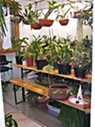

La soluzione che ho adottato è relativa al fatto che avevo una "stanza in più" di circa mt. 4,50 x 4,00.

Coltivando tutto l’ anno in quella stanza avevo il grosso problema dell’ umidità per pareti e pavimento (in legno), perché ormai il numero elevato di piante (150), non mi permetteva più di portarle in terrazzo durante l’ estate, così con l’ aiuto di un amico artigiano dalle mani d’oro ho isolato la stanza.

Ecco come:

a) pareti e soffitto con dei pannelli di polistirene, un materiale che si usa in edilizia per l’isolamento dei muri, è leggerissimo e ignifugo (cosa da non sottovalutare), i pannelli sono fissati tra loro con il silicone e in alcuni punti della parete con dei chiodi d’acciaio.

b) Il pavimento è a pannelli fatti con un doppio strato di alluminio coibentato, sono uniti tra loro con il silicone e per maggior sicurezza anche con del nastro adesivo di alluminio. Per sigillare la congiunzione tra pavimento e pareti è stato messo un piccolo battiscopa e sigillato il tutto con il silicone.

c) La luce naturale proviene da una ampia finestra dotata di doppi vetri, orientata ad ovest e schermata da una tenda di tessuto-non-tessuto durante l’ inverno. D’estate aggiungo un altro strato di tessuto-non-tessuto e una pellicola ombreggiante di quelle per auto.

d) La luce artificiale è data da 10 tubi al neon della Philips posti a gruppi di 2, 1 a luce rossa e 1 a luce bleu. Per avere nella parte alta più luce ho utilizzato anche due fari posti al centro del soffitto su due staffe, 1 ai vapori di sodio e 1 ai vapori di alogenuri, orientati in modo tale da mescolare i due fasci di luce, il calore di tutte queste luci rialzano la temperatura diurna invernale a valori ottimali sui 20/21 gradi. Le luci rimangono accese per circa 14/16 ore.

e) Per le calure estive utilizzo un aspiratore "Vortice", posto nella parte bassa del’ elemento fisso della porta scorrevole e collegato ad un tubo flessibile alto 2 mt, immette l’ aria fresca dell’ impianto di aria condizionata di casa.

f) La ventilazione è data da due ventilatori oscillanti, posizionati nei due angoli opposti e rivolti contro la parete e posizionati verso l’ alto.

g) Per avere una umidità tra il 70 e 85% utilizzo 3 umidificatori Honewell.

Per isolare la "serra" dal resto dell’ appartamento, ho applicato un infisso di alluminio da esterno con una porta scorrevole in policarbonato, sigillando tutto il perimetro con silicone; con questo sistema sono sicura che l’ umidità rimane tutta all’ interno della serra. Per sistemare le piante ho utilizzato 5 fioriere in ferro battuto a gradini addossandole alle pareti, centralmente ho posto un tavolo da birreria per sistemare le piante più grandi, un tavolo da lavoro è posizionato contro la parete opposta alla finestra. Per appendere le piante con più bisogno di luce ho messo dei tubi di rame sospesi con delle catenelle regolabili.

Con questa sistemazione riesco a tenere piante da serra intermedia e calda e tra i doppi vetri anche quelle che gradiscono un riposo al fresco durante l’ inverno.

Nella foto potete vedere come sono disposte le piante nella stanza adibita a serra.

