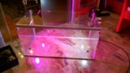
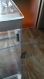
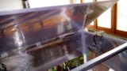
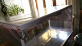
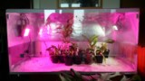

Scopo: realizzare una semplice scatola, non a tenuta ermetica, con condizioni ambientali (abbastanza) controllabili per fornire un ricovero invernale alle piante in fase di dipartita (ovviamente nella speranza di farne resuscitare il più possibile) o specie delicate o appena “sbeutate”.

Requisiti:

\- un posto dove metterlo

\- pannelli pretagliati in plexiglass:

A) n° 2 da cm 50 x 50 spess. mm 4;

B) n° 2 da cm 100 x 50 spess. mm 2;

C) n° 2 da cm 100 x 50 spess. mm 4;

\- profili in alluminio a “L” quanto basta come angolari

\- silicone per plexiglass

\- 4 cerniere in acciaio e relative viti e bulloni

\- 2 chiusure magnetiche (e relative viti e bulloni)

\- foglio d'alluminio (per intenderci quello che si usa per cuncinare)

\- foglio in PVC (ca. cm 110 x 60 )

\- scotch resistente all'umidità

\- Materiali extra:

\- rete zincata (cm 100 x 30, da cm 1)

\- lt. 10 di perlite

\- 2 lampade LED "tropicalizzate" (di cui una fitostimolante da 12 w, led con copertura spettrale su 4 lunghezze d'onda e un faretto luce fredda da 10 w)

\- 1 termostato con cavo riscaldatore da fondo per terrari ( 25 w con cavo attivo da m 2,50)

\- 1 timer

\- attrezzi da lavoro

Tempo d'esecuzione, ca 2 giorni (più che altro per aspettare la presa del silicone)

Costo: 150 euro, cifra indicativa ma dipende anche dove si acquista il materiale, la qualità o se si è già in possesso di qualcosa.

molti dei materiali sono adattabili alle proprie esigenze sia in tipologia che in quantità/qualità

Metodo: ho creato 2 righe di (7) fori con la punta da 1 cm sulle lastre "A" verso la base come fori di ventilazione e predisposto degli incavi per i cavi sul bordo superiore. Fatte altre 2 righe di (15) fori per ventilazione, in alto su quella che diventerà l'anta anteriore (una lastra "B"). Quest'ultima l'ho tagliata in 2 parti, una alta 15 cm che sarà la parte fissa da incollare sulla lastra della base, la restante coi fori sarà la parte apribile a ribalta.

Ho predisposto i fori per le cerniere in modo da poter aprire le pareti in alto e davanti.

Assemblaggio: ho siliconato le 2 lastre "A" (pareti laterali) sopra una lastra "C" (che fa da base), una lastra "B" va incollata per formare la parete di fondo; della parete anteriore ho incollato solo la parte bassa, quella alta cm 15 che avevo tagliato, e rimane fissa.

24 ore di attesa per il fissaggio del silicone.

Ho fissato le cerniere alla lastra “C” di copertura e a quella che rimaneva per l'anta anteriore, avvitati i fermi magnetici per le ante. Scotchato le pareti fisse e siliconato i profili d'alluminio sugli spigoli delle stesse per irrigidire il tutto.

Per favorire la riflessione della luce delle lampade, ho rivestito all'esterno col foglio d'alluminio: la parte alta delle pareti laterali, quella di fondo e il coperchio (il tutto semplicemente fissato con dello scotch).

Messo sulla base il foglio di PVC ripiegato ai lati a mo' di vaschetta, versata parte della perlite, disteso il cavo riscaldante con sonda e coperti con la restante perlite, appeso sul fondo la rete zincata (per appendervi le zatterine) e appesi i 2 faretti ai lati interni.

Versati 2 litri d'acqua sulla perlite, collegati termostato, le luci al timer e acceso il tutto.

Inserite le piante.

Finito

Condizioni di esercizio: una botta di luce per 12 ore al giorno, temperatura del fondo ca. 27°C, temperatura dell'aria ca. 18°C, umidità al 98% costante.

Cosa non va... :

le lastre di plexiglass da mm 2 sono troppo sottili e s'imbarcano e muovono.

Il taglio delle lastre da 2 mm, fatto con il taglierino, può risultare impreciso o dare luogo a rotture indesiderate.

Il silicone specifico per plexiglass... NON TIENE! … è questo il motivo per cui son dovuto ricorrere allo scoth da esterni.

Cosa funziona...:

Aprendo l'antina esce “profumo di serra”

A un mese dalla messa in funzione, sembra le piante gradiscano, quanto meno non sono peggiorate.

Considerazioni: non è un brutto oggetto ma è un poco “raffazzonato su” e dà l'impressione di essere un collage di pezzi... una roba tipo mostro di Frankenstein. Ma l'estetica non era certo una priorità.

Il ricambio d'aria avviene in maniera molto delicata e l'umidità interna al 98% fa sì che l'acqua delle spruzzature non evapori che dopo moltissime ore e che le foglie rimangano umide per alcuni giorni: non so quanto farà bene alle piante. Il composto dei vasi, al contrario, s'asciuga abbastanza velocemente causa il contatto con la perlite riscaldata.

Se dovessi farne un altro, alcune cose le farei in maniera diversa, tipo l'apertura anteriore che, essendo a ribalta, può risultare poco pratica.

Avrò tutto l'inverno del 2016 per verificare il corretto funzionamento e la validità del tutto.

