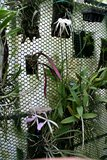
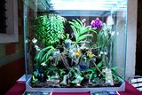
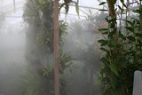
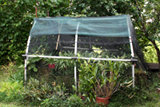
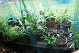
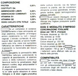

Per coltivare le piante e in particolare le orchidee bisogna aver cura di mantenere sotto controllo soprattutto tre fattori: **la temperatura**, **la luce** e **l'umidità**.

## La temperatura

La temperatura regola il ritmo delle attività di una pianta: produrre nutrimento, usarlo, riprodursi.

Ogni pianta ha un proprio intervallo di temperatura ottimale per la crescita.

**Microclimi standardizzati per alcuni generi d'orchidee**

**Serra Fredda**: temperatura minima notturna invernale: 10°C ; massima 27°C: serra adatta a Cymbidium, Masdevallia, Miltonia, Odontoglossum, Oncidium.

**Serra Intermedia**: temperatura minima notturna invernale: 13°C; massima 30°C: serra adatta a Brassavola, Cattleya, Dendrobium, Epidendrum, Laelia, Paphiopedilum.

**Serra Calda**: temperatura minima notturna invernale: 15°C; massima 32°C: serra adatta a Phalaenopsis, Vanda.

Per brevi periodi (ore, non giorni) le orchidee possono sopportare anche temperature maggiori o minori. Le temperature massime non sono quasi mai un fattore limitante.

I sistemi di riscaldamento sono i più vari e spesso condizionati dal risparmio economico, il vostro termotecnico di fiducia potrà consigliarvi riguardo al metodo migliore da applicare e la quantità di elementi da usare. Per il raffrescamento estivo è invece d'uso il “cooling”(“raffrescamento” per l'appunto). Su di un elemento verticale idrofilo e poroso all'aria, viene fatta percolare dell'acqua, simultaneamente viene forzata dell'aria a passare orizzontalmente attraverso lo stesso: l'evaporazione dell'acqua comporta un assorbimento di calore a scapito dell'aria che l'attraversa e creando così un flusso d'aria a temperatura sensibilmente più bassa dell'ambiente crcostante.

## La luce

Le orchidee sono le figlie dell’aria e della luce.

In effetti certune si sviluppano e fioriscono con il sole, altre si accontentano solo della penombra della foresta tropicale, ma la maggior parte abbisogna di luce abbondante, anche se non diretta.

Questo bisogno di sole è legato al loro modo di vivere “nell’aria”.

Molte specie, come per es. le Vanda, amano il pieno sole, altre, come le Phalaenopsis, crescono meglio ad una luce di più bassa intensità.

Fortunatamente le orchidee sono piante adattabili e possono essere coltivate con un “range” di luce di intensità diversa, senza eccessivo danno per le piante.

## L'umidità

Nei paesi tropicali fa caldo, ma soprattutto c’è un’umidità media sicuramente più elevata che da noi.

Nelle regioni temperate si alternano le quattro stagioni; nella maggior parte delle regioni tropicali esistono soltanto due periodi: “la stagione delle piogge” e “la stagione secca”.

Questa condizione tende a scomparire nelle foreste pluviali (rain forest) e nelle terre alte o zone dominate dalle nebbie (cloud forest).

Nel periodo secco, in genere, le orchidee vanno in riposo, si rinfrescano con la nebbia della notte o con la rugiada del primo mattino, pronte a risvegliarsi alle prime piogge, portando a termine lo sviluppo vegetativo, prima che arrivi un nuovo periodo di siccità. Molte piante fioriscono all’inizio della stagione delle piogge, altre a maturazione completata.

Nella coltivazione va rispettato il periodo di dormienza delle orchidee.

Il periodo attivo coincide con la comparsa dei nuovi germogli. In questo periodo, finchè il nuovo germoglio raggiungerà qualche centimetro e saranno apparse nuove radici, la pianta andrà mantenuta piuttosto asciutta, poco fertilizzata, per evitare che l’acqua faccia marcire la giovane vegetazione.

Quando le radici avranno fatto presa sul composto le inaffiature dovranno riprendere, magari associate ad una concimazione ricca d’azoto, sino a quando il nuovo pseudobulbo ( la nuova vegetazione) non sia diventato bello turgido. Quando il nuovo pseudobulbo ha smesso di crescere le bagnature vanno diminuite, in questo periodo può essere utile associare a un concime bilanciato.

Ricomincerà così un nuovo ciclo.

E' possibile coltivare un certo numero di specie nella normale umidità della casa, tuttavia una zona che può ricevere una umidità supplementare (ad esempio da un umidificatore) è sempre preferibile.

In alternativa per avere un giusto microclima, si può ricorrere all'utilizzo di ampi sottovasi riempiti con uno strato d'argilla espansa e in cui versare dell’acqua senza che questa tocchi il fondo dei vasi.

Volendo una base d’appoggio omogenea per i vasi, si può collocare sopra l'argilla espansa una rete d’acciaio.

## La ventilazione

In natura le piante sono accarezzate dalle brezze e scosse dai venti.

Anche in serra è molto importante che, tanto di giorno che di notte, in ogni stagione, l’aria circoli.

Nei giorni di sole è bene aprire il locale dove sono ospitate le piante in maniera da far arrivare all’interno aria fresca, così da tenere sempre un’aria “viva” nella serra o nell’orchidario.

Se la coltivazione avviene in serra o in una veranda, durante l’inverno i locali possono diventare molto umidi, cambiare aria serve a procurare sollievo alle piante e a prevenire malattie.

L’aria che circola non danneggia le piante, purchè sia della temperatura giusta e contenga sufficiente umidità.

## Le annaffiature

L’acqua è un elemento indispensabile per la crescita delle orchidee; tuttavia le piante non devono esser annegate… è questa infatti la causa maggiore di decesso delle orchidee.

E’ preferibile utilizzare l’acqua piovana a temperatura ambiente.

**Bagnare molto: quando**

\- Quando c'è forte luminosità (primavera estate);

\- La temperatura è in aumento;

\- L’areazione è forte;

\- Le foglie sono abbondanti;

\- La pianta è in piena vegetazione;

\- Il substrato è poroso (bark grosso);

\- Il vaso è in terracotta;

\- Il vaso è piccolo;

\- La pianta è coltivata su zattera;

\- L’umidità è al di sotto del 40%;

**Bagnare meno: quando**

\- C'è bassa luminosità (autunno-inverno);

\- La temperatura diminuisce;

\- C'è un insufficiente giro d’aria;

\- Rimangono poche foglie (per le piante a vegetazione stagionale);

\- La pianta è a riposo

\- Il substrato tiene bene l’acqua;

\- Il vaso è in plastica;

\- Il vaso è grande;

\- La pianta è appena stata rinvasata;

\- L’umidità è del 70% o più.

## La concimazione

Le orchidee nei paesi di origine sono bagnate dalla nebbia, dalla rugiada e dall’ acqua piovana. Le loro radici penetrano nelle spaccature della corteccia o negli anfratti, dove ci sono materie organici in decomposizione come foglie, insetti, escrementi di uccelli ecc.

Poichè il substrato di coltura usato nella coltivazione domestica è un substrato inerte, bisognerà provvedere a fornire alle orchidee gli elementi necessari alla crescita ed allo sviluppo.

I principali costituenti dei tessuti vegetali sono:

carbonio, idrogeno, ossigeno, azoto, fosforo, potassio, calcio, manganese e zolfo, oltre beninteso l’acqua.

Carbonio, idrogeno, ossigeno, vengono prelevati dall’aria e dall’acqua; gli altri elementi vengono prelevati dal terreno, disciolti nell’acqua, tramite le radici.

Le piante assorbono anche in quantità minima di micro elementi come boro, rame, zinco, manganese.

In primavera ed in estate è bene, anzi indispensabile, concimare spesso le piante (meglio piccole concentrazioni, ma frequenti) mentre in autunno la fertilizzazione andrà rallentata fino ad esser sospesa quasi del tutto in inverno.

I concimi hanno una formula internazionale N-P-K (azoto-fosforo-potassio) e per lo più vengono utilizzati in forma bilanciata (18 -18 – 18 o 20 – 20 – 20).

In primavera, per favorire lo sviluppo della vegetazione, si forza con l’azoto, cioè si usa la formula tipo: 30 – 10 -10; per favorire una maggior fioritura si diminuisce l’azoto e si aumenta il fosforo (10- 30- 20).

I concimi vengono disciolti in acqua nella concentrazione del dell’1% se usati in media una volta la settimana. E’ bene non superare mai il grammo per litro.

Si raccomanda di effettuare le concimazioni sul substrato umido e buona regola impone che le piante concimate non siano mai lasciate asciugare completamente.

## Il rinvaso

Una orchidea epifita va rinvasata solamente quando é cresciuta troppo, quando il substrato non è più in grado di assicurare sufficiente aerazione alle radici perché si è deteriorato (in genere decomposto e quindi rimane costantemente umido ed “impaccato”) sì da creare una situazione asfittica, oppure quando risulta infestato da parassiti o da muffe.

In questi casi la pianta dopo esser stata bagnata (in modo da rendere più elastiche le radici) va mondata di tutti pezzi di substrato vecchio e di tutte le radici morte o danneggiate, previa sterilizzazione della cesoia.

La pianta va poi messa a dimora in un contenitore di giuste proporzioni (in genere piccolo se rapportato ad altri generi di piante), debitamente pulito (si disinfetta con varechina diluita e poi si sciacqua abbondantemente) e allo stesso saldamente ancorata (con del filo di ferro o con appositi tutori).

I vasi di plastica con grossi fori drenanti sul fondo sono ormai di uso comune.

I vasi vanno riempiti del nuovo composto facendo attenzione di porre i pezzi più grossi sul fondo del vaso per migliorare il drenaggio.

Quando si rinvasa col bark è consigliato pre-bagnare il nuovo materiale nei giorni immediatamente precedenti l’operazione per pulirlo e renderlo permeabile all’acqua.

Dopo il trapianto la pianta va lasciata a secco ed a riposo in posizione protetta dalla luce diretta e dagli sbalzi di temperatura per una settimana circa, per consentire alle parti tagliate di cicatrizzare e quindi gradatamente vanno riprese le bagnature.

E’ preferibile rinvasare una pianta all’inizio della nuova vegetazione, quando appaiono le prime radici (e queste sono lunghe uno o due centimetri), quando le piante dimostrano cattiva salute, quando le radici sono marce o mangiate dalle chioccioline.

Con il rinvaso si darà nuova linfa alla pianta che in poco tempo formerà nuove radici e recupererà buona aspetto.

## La coltivazione su zattera

Ci sono piante che crescono meglio se coltivate su zattera (un pezzo di tronco, un tralcio di vite, un pezzo di sughero).

Tra queste alcuni Oncidium che devono asciugare subito dopo essere stati bagnati; le orchidee con i rizomi lunghi come i Bulbophillum, alcuni Dendrobium, le piante che si arrampicano come gli Epidendrum e le Maxillaria sono piante che preferiscono essere coltivate in zattera.

Anche alcune piante da serra fredda possono adattarsi meglio in una serra intermedia se le radici sono completamente esposte all’aria.

Il miglior momento per trasferire la pianta sulla zattera è quando le radici cominciano ad apparire alla base della nuova vegetazione.

La zattera andrà tagliata e sagomata in base alla grandezza della pianta da appendere e munita di un gancio per appenderla. Le orchidee vanno fissate alla zattera usando filo di rame o di nylon usato per la pesca, oppure strisce di calze in nylon da donna.

Esaminata la pianta per trovare il suo verso per adattarla al supporto, deve essere ben fissata alla zattera affinché non si muova. Si suggerisce di porre dello sfagno o, in mancanza, anche del normale muschio ben lavato, tra la pianta e la zattera per assicurare un’umidità maggiore fino alla crescita delle radici.

Le piante coltivate in questo modo richiedono maggior umidità, ma non abbisognano di più acqua rispetto alle altre piante, ovviamente si adattano meglio alla coltivazione nella serra o nell’orchidario.

## La coltivazione in luce artificiale

Trovato un piano d’appoggio, bisognerà pensare alla luce.

Alcune specie si adattano meglio di altre alla coltivazione in casa, tra queste i Cymbidium che tuttavia richiedono un periodo fresco e in piena luce per indurre la fioritura (come ad esempio una finestra sulle scale). Questo periodo deve essere mantenuto tale sino a completa schiusa dei fiori.

I Paphiopedilum che possono esser coltivati sul davanzale assieme agli ibridi di Oncidium e di Miltonia, e le Phalenopsis che gradiscono una temperatura costante mai inferiore ai 15 °C. ma senza sole diretto (cucina o bagno per la maggior umidità presente nell’ambiente).

Se, invece, pensiamo di coltivare le piante solo sotto la luce artificiale, possiamo usare normali lampade al neon montate nei rispettivi riflettori, fissate orizzontalmente sopra il piano d’appoggio.

Al fine di ottenere una crescita ottimale e una apprezzabile resa visiva dei fiori, è consigliabile mescolare lampade di diversa “temperatura-colore”: “WHITE” e “COOL WHITE” possono essere una scelta economica ed eccellente.

**MATERIALE OCCORRENTE PER LA COLTIVAZIONE IN LUCE ARTIFICIALE**

\- Lampade al neon, secondo la lunghezza e larghezza del piano d’appoggio.

\- Un timer per la regolazione del tempo di illuminazione.

\- Un igrometro per misurare l’umidità.

\- Vaschette d'argilla espansa e griglie per l’appoggio.

\- Un termometro di minima-massima.

\- Un ventilatore.

Sotto luce artificiale bisogna tenere presente che:

\- una crescita debole con assenza di fioritura, è indice di luce insufficiente;

\- una crescita debole e lenta, con tendenza all’avvizzimento, è indice di un ambiente di coltivazione troppo secco;

\- un'assenza di fioritura in presenza di buona crescita, è indice di eccessiva esposizione alla luce.

Sono di introduzione recente i pannelli a LED, tra i pregi si possono annoverare:

\- l'ottimizzazione delle frequenze luminose tarate sul massimo assorbimento da parte della clorofilla

\- l'elevato flusso luminoso, merito della maggiore efficienza di conversione dell'energia elettrica

\- riduzione della generazione di calore

\- bassi consumi;

Gli aspetti negativi:

\- pessima resa cromatica dei colori dei fiori e dell'aspetto in generale (con l'uso dei LED colorati)

\- flusso luminoso concentrato e conseguente incremento del numero di LED da utilizzare

\- come conseguenza del precedente punto, vanificazione del vantaggio economico sia in termini di costo unitario per LED che

per la spesa dovuta al consumo elettrico.

Si può dire che i LED sono utili come fonte di luce addizionale... non allo stato attuale.

## L'orchidario

L’orchidario è una piccola casa per le nostre piante, simile ad un grande acquario o a un rettilario (in commercio se ne trovano di bellissimi in metallo o in legno).

La sua principale collocazione è in appartamento e lo scopo consiste nel riprodurre in piccolo un pezzetto di foresta, ovviamente, le modeste dimensioni consentono di coltivare un numero limitato di piante.

Sul fondo impermeabilizzato andrà posizionato del materiale come sabbia, agriperlite o argilla espansa. Su questo letto di materiale che serve a mantenere l’umidità, possiamo appoggiare vasi e piante di modeste dimensioni, e, con un po’ di estro, si può ricreare un vero paesaggio tropicale dove le piante miniatura sono posizionate su un grosso tronco di legno resistente al marciume (la vite può essere un'ottima scelta), mentre quelle di maggior dimensioni fanno da sfondo.

L’illuminazione può essere naturale od artificiale: nel primo caso l’orchidario addossato ad una finestra prende luce dall’esterno, nel secondo caso la luce è artificialmente fornita da tubi fluorescenti.

Per non incorrere nell’errore dei primi coltivatori, che uccidevano le orchidee “cuocendole”, l’orchidario dovrà esser provvisto di prese d’aria fresca in basso con una ventola dinamica in alto o in alternativa di un piccolo ventilatore.

L’“armadio per orchidee”, come lo chiamano i tedeschi, va posizionato in prossimità di una finestra esposta ad est sì da non richiedere ombreggio nelle ore più calde. Se non è possibile addossarlo ad una finestra dovrà esser munito di timer per l’accensione delle luci.

Se la stanza è particolarmente fredda una forma di riscaldamento è costituita da una resistenza posizionata sul fondo, la potete acquistare nei negozi d'acquari, che va accesa e spenta con apposito termostato di minima e di massima.

Ricordate che uno spazio di volume limitato è soggetto a bruschi cambiamenti di temperatura ed umidità perchè non ha inerzia termica.

Le annaffiature, da effettuarsi comunque al mattino, dovranno succedersi per mantenere al giusto grado l’umidità. Sarà particolarmente utile posizionare all’interno dell’orchidario un piccolo igrometro ed un termometro che indichi le temperature minime e massime.

## La serra

E’ il sogno di tutti i coltivatori, ed è indice che il livello di contaminazione da orchidee è ormai irreversibile.

Scherzi a parte è la serra l’ambiente più adatto per la coltivazione delle nostre piante alle nostre latitudini: ha il vantaggio di ricevere luce da almeno tre lati fino a cinque, infatti ha tetto e pareti in materiale trasparente (vetro, policarbonato, nylon).

Le serre meno costose e più semplici sono a tunnel con due film di nylon distanziati con dell’aria compressa da una piccola pompa.

Le serre più belle, ma più costose, possono esser addossate ad una parete oppure esser sistemate isolate nel mezzo di un giardino. Preferibili sono quelle costruite in alluminio anodizzato e vetro che non richiedo manutenzione. La moderna tecnologia consente di trovarne di fattura veramente eccezionale a un costo tutto sommato limitato.

Sia di produzione industriale che autocostruita, la serra deve rispettare alcuni standard di altezza, lunghezza, larghezza e pendenza delle falde del tetto.

Una serra deve aver spazio sufficiente in altezza per consentirci di entrare in piedi e appendere delle piante al soffitto; deve esser abbastanza larga per permettere di avere due o tre bancali su cui appoggiare le piante e i relativi passaggi nel mezzo. La misura minima è di 3,60 x 5-6 metri. Se è possibile, la serra per le orchidee deve essere interrata per circa un metro; questo accorgimento consente di mantenere più elevato il grado di umidità e di risparmiare sul riscaldamento.

E’ fondamentale curare l’orientamento della serra rispetto al sole. Vale la stessa regola adottata per la coltivazione delle piante alla finestra: meglio est-ovest che nord-sud (nel senso della lunghezza).

Deve esser posta a una distanza tale che gli altri fabbricati e le piante di alto fusto non possano proiettare la loro ombra su di essa.

Nel caso in cui la serra venga addossata è preferibile che ciò avvenga sul lato est-sud dell’edificio. Una serra addossata ha diversi vantaggi: minor dispersione di calore, ridotte condotte di luce e acqua, possibilità di sfruttare un impianto di riscaldamento esistente.

La serra come, un appartamento, necessita di condizionamento. Si dovrà munire di impianto di riscaldamento ad aria, ad acqua o elettrico, di ventilatori per far muovere l’aria, di termostati di minima e di massima per regolare riscaldamento e raffreddamento, di un sistema di irrigazione. A queste dotazioni base può esser aggiunto il fog: un sistema per produrre nebbia, e il cooling: un sistema di raffreddamento. Per appoggiare le piante, dovranno esserci dei bancali in alluminio o ferro zincato. Sul tetto va previsto il supporto per un telo di ombreggiatura.

Suggeriamo di rivolgervi a ditte specializzate che sono in grado di darvi un prodotto completo ed integrato, oggi, a costi veramente vantaggiosi.

## L'esterno

Ultimo e non disprezzabile ambiente di coltivazione è “l'aria aperta”.

Chi gestisce un limitato numero di piante e ha a disposizione uno spazio all'aperto, troverà che la villeggiatura estiva delle orchidee non può che far loro del bene. Da fine aprile a metà ottobre, nei nostri climi, le piante possono stazionare in pien'aria, magari sotto a un pergolato o riparate da una siepe dal sole delle ore più calde.

La possibilità di godere di molta luce, dell'acqua delle piogge e della naturale escursione termica diurna fa sì che le vostre piante si rinvigoriscano e per alcuni mesi vi sgravino di parte dell'impegno che la coltivazione in ambiente completamente artificiale comporta.

Da curare con attenzione il periodo del ritiro al coperto a fine stagione estiva, tenete presente che la pianta subirà un piccolo stress nel ritornare nelle situazioni generalmente meno favorevoli della serra e che vi si prospetta il periodo sfavorevole dell'inverno in cui le piante non saranno favorite alla crescita e recupero di eventuali maggiori stress.

Controllate con cura che i vasi siano esenti da sgraditi ospiti, in genere chiocciole e lumache.

Inoltre valutate che se una pianta, durante la stagione precedente occupava una posizione negli scaffali, dopo la crescita estiva potrebbe sorprendervi con le nuove dimensioni e non riuscire a stare nello stesso posto occupato nell'anno precedente.

## Gli Amminoacidi

**Introduzione**

Gli amminoacidi sono i componenti strutturali che, legati tra loro, costituiscono le proteine.

Le proteine mediano tutti i processi che hanno luogo nelle cellule animali e vegetali e svolgono un numero enorme di funzioni.

Poiché ogni amminoacido ha specifiche proprietà chimiche, i venti tipi esistenti possono essere considerati come l’alfabeto con cui è scritto il linguaggio della struttura delle proteine.

Le cellule sono in grado di produrre proteine dotate di proprietà e di attività diverse, semplicemente unendo i venti amminoacidi in molte combinazioni differenti.

Grazie a loro, le piante possono generare: ormoni, enzimi, trasportatori, fibre vegetali, veleni fungini e migliaia di altre sostanze che posseggono attività biologiche specifiche.

Come abbiamo potuto capire, gli amminoacidi sono già presenti naturalmente in tutte le parti della pianta, quindi essi vanno somministrati solamente in due casi:

a) quando c’è la necessità di ristabilire il normale stato fisiologico della pianta (es. dopo un rinvaso)

b) quando c’è la necessità di aumentare la loro quantità per far fronte ad un futuro stress imposto (es. trattamento insetticida)

**Spieghiamo di seguito il diverso funzionamento degli amminoacidi nei due casi**

a) A causa del rinvaso, le funzioni fisiologiche delle piante si bloccano in seguito allo stress prodotto.

A questo punto, fornendo loro degli amminoacidi, si permette loro di avere il materiale base per ricominciare a produrre i tessuti di assorbimento e riattivare le normali funzioni fisiologiche, riducendo i tempi di ripresa.

b)A causa di un attacco di cocciniglia le piante colpite vengono indebolite.

Somministrando gli amminoacidi prima del trattamento si permette alle piante di recuperare un po’ di tono e di vigore in maniera da poter assorbire meglio e utilizzare in maniera più efficace il trattamento che viene somministrato.

Le piante possono così riprendersi più velocemente e ristabilire le loro funzioni fisiologiche.

**Gli amminoacidi si usano:**

\- dopo i rinvasi

-prima e dopo i trattamenti

-dopo il periodo di riposo invernale

-dopo uno stress termico, idrico

-dopo un cambio di collocazione ambientale

-dopo uno stress fisiologico (clorosi)

**Gli amminoacidi non si usano:**

-puri

-in unione ai trattamenti (possibile sviluppo di tossine)

-in unione al concime

-per periodi prolungati (inibizione della produzione da parte della pianta)

-in sostituzione al concime

**Impiego degli amminoacidi**

Esistono due modalità di somministrazione degli amminoacidi:

\- per nebulizzazione fogliare

\- per annaffiatura del composto.

La dose da aggiungere all’acqua di nebulizzazione dev’essere maggiore rispetto a quella d’annaffiatura.

Gli amminoacidi vanno dati solamente nelle giornate di bel tempo, perché è il periodo in cui la pianta presenta un metabolismo più attivo.

L’intervallo tra un’applicazione e la successiva dev’essere di almeno una settimana ma è consigliabile attendere tra i dieci e i quindici giorni.

L’impiego degli amminoacidi non dev’essere protratto per un periodo eccessivamente lungo poiché tale comportamento può influire negativamente sui ritmi biologici e fisiologici della pianta (la pianta rischia di diminuire la produzione propria di amminoacidi).

**Come mantenere gli amminoacidi**

Gli amminoacidi sono sensibili alle alte temperature ed alle radiazioni solari intense: superati i 70°C o lasciati per lungo tempo in pieno sole si denaturano.

E’ quindi preferibile mantenerli in luogo fresco, lontano da fonti di calore e all’ombra.

Consigli per l’acquisto di amminoacidi

Spesso si trovano in commercio amminoacidi uniti a concimi o a ormoni.

Queste confezioni sono fortemente sconsigliate, in quanto non assolvono correttamente la funzione desiderata.

E’ preferibile comprare amminoacidi puri o con l’aggiunta di vitamine (vitamina D, B, E) e microelementi (Fe, Br, Al, Mn, etc…).Impiego degli amminoacidi

Esistono due modalità di somministrazione degli amminoacidi: per nebulizzazione fogliare e per annaffiatura del composto.

La dose da aggiungere all’acqua di nebulizzazione dev’essere maggiore rispetto a quella d’annaffiatura.

Gli amminoacidi vanno dati solamente nelle giornate di bel tempo, perché è il periodo in cui la pianta presenta un metabolismo più attivo.

L’intervallo tra un’applicazione e la successiva dev’essere di almeno una settimana, è consigliato attendere tra i dieci e i quindici giorni.

L’impiego degli amminoacidi non dev’essere protratto per un periodo eccessivamente prolungato poiché tale comportamento può influire negativamente sui ritmi biologici e fisiologici della pianta (la pianta rischia di diminuire la produzione propria di amminoacidi).

Come mantenere gli amminoacidi

Gli amminoacidi sono sensibili alle alte temperature ed alle radiazioni solari intense: superati i 70°C o lasciati per lungo tempo in pieno sole si denaturano.

E’ quindi preferibile mantenerli in luogo fresco, lontano da fonti di calore e all’ombra.

**Consigli per l’acquisto di amminoacidi**

Spesso si trovano in commercio amminoacidi uniti a concimi o a ormoni.

Queste confezioni sono fortemente sconsigliate, in quanto non assolvono correttamente la funzione desiderata.

E’ preferibile comprare amminoacidi puri o con l’aggiunta di vitamine (vitamina D, B, E) e microelementi (Fe, Br, Al, Mn, etc…).

A titolo esclusivamente esplicativo si allega esempio di etichetta di un prodotto commerciale

