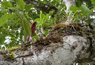
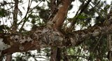
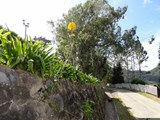

(ndr.: questa non è propriamente un' “esperienza di coltivazione” vista l'unicità del caso. Ciò non toglie che la cosa sia interessante per noi che siamo abituati al diserbo delle margherite che ci “sporcano il prato di casa”)

Le foto ritraggono un insieme di specie diverse d'orchidea tutte sullo stesso ramo, ramo che non appartiene ad un albero cresciuto selvatico nel bosco, bensì di un albero di avocado piantato dietro casa (in Venezuela).

E' possibile scorgere un esemplare di Cattleya ( probabilmente mossiae ), un Epidendrum difforme, un Epidendrum ferrugineum, 2 diverse Restrepia spp., una specie probabilmente di Enciclia e una orchidea piccola piccola che non conosco.

L'ultima riprende uno scorcio di strada con muretto a secco nelle cui fessure crescono e fioriscono degli Epidendrum sp.

