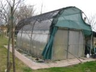
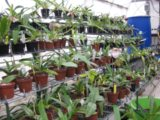
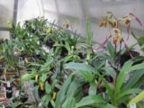
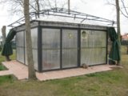

Succede spesso che nel seguire il proprio personale hobby, per volontà o per istinto, si sviluppino delle preferenze: nel caso di Graziano questo si concretizza in un “debole” per i Paphiopedilum.

Graziano, forte dei suoi contatti con personaggi di spicco del mondo orchidofilo, può aspirare ad una lista di piante di assoluto rilevo, siano esse specie che ibridi.

Per la coltivazione dei Paphiopedilum, destina a questo scopo una serra esclusiva: non v'è dubbio che questa opportunità faciliti di molto la coltivazione riuscendo a dettagliare le cure in base alle esigenze delle varie orchidee.

Notevole l'ordine e la cura con cui Graziano dispone i vasi di paphio a tutto vantaggio anche del contenimento delle possibili cause di malattia.

L'ordine e la cura non esentano Graziano dal seguire le sue piante, automatizzazioni e olio di gomito sono un altro ingrediente fondamentale per la buona riuscita del tutto.

L'apparato tecnico, di tutto rispetto (lo si nota dall'adozione dell'ultimo dispositivo antifurto “Chiusura a pala” nella foto principale), si distingue per l'impiego dell'energia geotermica che rappresenta un notevole aiuto, in termini economici, al contenimento delle spese di riscaldamento, e l'impiego di un duplice strato di policarbonato per la copertura della serra.

Alla serra dedicata alle Cypripedioideae” si affianca una più “usuale” serra per orchidee generiche dove Graziano ripropone gli schemi di coltivazione prima menzionati.!P!E i risultati non mancano certo ad arrivare... e nella sezione “Orchidee dei soci” trovate parte di questi risultati.

