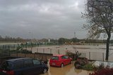
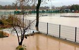
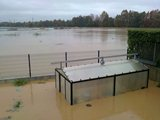
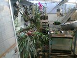
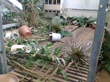
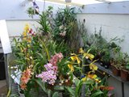

Carissimi; voglio condividere con Voi la mia esperienza dell'autunno 2010 che spero proprio non si ripeterà mai più.

Dovete sapere che nell’estate del 2010 finalmente il sogno di una vita si è concretizzato.

Con il riordino dello spazio esterno di casa mi sono deciso a costruire una serra.

Lo spazio esterno non era molto e, per evitarne l’impatto visivo, mi sono deciso per una soluzione interrata e di piccole dimensioni (mt 3 x 5) ma per me sufficiente.

Ho predisposto uno scavo adeguato con dei bei muri di contenimento in cemento. Sul lato ovest ho anche fatto realizzare una scaletta in calcestruzzo. La coibentazione interna è stata fatta con pannelli tipo stirodur da 3 cm. Approfittando del fatto di avere una sorgente locale di acqua a circa 14°, con un termostato e due vecchi termoconvettori ho predisposto un sistema di raffrescamento. Anche il riscaldamento era pronto per il suo primo inverno: predisposto con il gas metano. Il tetto in policarbonato da 16 mm a doppia camera ha inclinazione nord-sud e poggia sui due muri nord e sud emergendo a nord di 50 e a sud di 20 cm dal piano giardino.

L’inaugurazione è avvenuta alla fine di luglio e le mie amiche orchidee ci stavano proprio bene.

Va detto che quelle proprio mie, visto che per anni non avevo avuto la serra, erano poche ma che i vecchi amici collezionisti per anni me ne avevano tenute come “ospiti” e comunque mi avevano passato le loro divisioni. Anche i nuovi amici incontrati in ATAO mi avevano regalato un bel po' di piante. Dai gardens avevo raccolto a prezzi stracciati piante sfiorite che si stavano riprendendo benissimo specie le Phalenopsis ed i Dendrobium.

Si erano così ben acclimatate che a settembre, alla mostra Viridalia di Thiene, ben due delle mie piante sono state premiate: una Vanda dai fiori rosa carico e uno Psychopsis papilio dal fiore particolarmente elegante. E’ stata una soddisfazione incredibile.

Tutto stava proseguendo benissimo quando il 1 novembre, senza che nulla lo preannunciasse, è successo il disastro.

Il Fiume Bacchiglione, a circa 3 Km da casa ha rotto gli argini. Abbiamo assistito impotenti alla salita di una marea che ha tutto travolto e che per ore ha continuato a crescere.

Ovviamente la nuova serra delle orchidee (e una vicina “serra fredda” con altre piante meno delicate) ne è stata subito integralmente sommersa ma, a dire il vero, è stata in quei giorni l’ultimo dei nostri problemi dato che anche il primo piano di casa era stato allagato.

Grazie Franco! Grazie Loris! Dopo un giorno siete arrivati voi. Gli angeli delle orchidee, i vecchi amici di sempre, per tre giorni avete lavorato senza fermarvi mai. Mentre io mi occupavo della casa voi due avete svuotato la serra, portato fuori tutte le piante, ripulito pareti e scaffali.

Immaginate le condizioni di una pianta rimasta per 48 ore immersa in un fango dall'identità indecifrabile e per giunta freddo e cosa ha significato il lavarle tutte, foglia per foglia, con l’idropulitrice. Grazie ancora amici: è grazie anche al vostro lavoro, e le foto lo dimostrano, che la mia serra è sopravvissuta.

Purtroppo parte dei materiali e delle attrezzature si sono ovviamente danneggiati o completamente rovinati e con l'inverno alle calcagna, il loro ripristino era pressante.

E’ ovvio che molte orchidee, specialmente le miniature o i giovani esemplari su corteccia, le Phalenopsis e il bellissimo Psychopsis papillo non ce l’hanno fatta, e altre avranno bisogno di tempi lunghi per la ripresa.

Come prima azione ho provveduto a fare un trattamento generale di fungicida (Previcur) nella speranza di contenere i possibili futuri marciumi poi null'altro se non continuare con la mia coltivazione “classica” spruzzando ogni giorno assieme all'acqua anche una parte, in percentuale, di fertilizzante e ormoni.

Va anche detto che, in modo incredibile, alcune orchidee stanno benissimo pur avendo passato un inverno difficile con il riscaldamento elettrico non sempre ben funzionante.

Ben triste sarebbe stata comunque la mia serra se gli amici orchidofili, e quelli ATAO in primis, non mi avessero regalato delle splendide piante che hanno riempito i tanti vuoti. Grazie quindi a tutti per essermi stati vicino con l’auspicio che l’alluvione 2010 resti un ricordo e che non si ripeta mai più.

