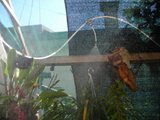
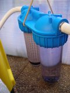

Questa è la descrizione di come ho realizzato, in “quattro e quatt'otto”, un impianto di nebulizzazione per il sito di soggiorno esterno delle mie orchidee.

Attrezzatura acquistata:

\- una idropulitrice hobbistica (300,00 €);

\- un timer da 24 ore diviso in quarti d'ora (in realtà poi mi son reso conto che bastano anche 6/7 minuti di funzionamento);

\- del tubo da aria compressa da 10 mm.(1,30 € al metro);

\- del tubo da aria compressa da 6 mm.(0,60 € al metro);

\- dei raccordi a T con riduzione da 10 a 6 (3,00/5,00 €);

\- 5 irrigatori nebulizzanti presi al Brico(7,00 € l'uno);

\- un filtro per acqua da 50 micron (avuto gratuitamente dalla fabbrica perché ha una piccola scheggiatura e non può essere venduto normalmente sennò costa sui 150 €);

\- 2 flessibili per collegare il filtro alla macchina (circa 30,00 €).

Come contenitore per l'acqua, ho recuperato una cisterna che una volta veniva usata per tenere l'acqua per i fiori e gentilmente concessa da mio suocero, l'ho collegata al filtro mediante un tubo in polietilene.

Ho chiesto al costruttore dell'idropulitrice se mi forniva un attacco rapido per tubo aria da 10 mm e poi ho assemblato il tutto. Per avere la garanzia di ottenere su tutta la linea la stessa pressione, ho fatto il tubo porta-ugelli ad anello e a metà ho inserito un raccordo a T con uno scarico aperto che ritorna direttamente in cisterna. Ho tagliato dei pezzi di tubo da 6 e dopo averli scaldandati con un accendino, vi ho inserito i nebulizzatori, il tutto raccordato ai pezzi a T ridotti e finalmente ho fatto funzionare il tutto.

Per l'impianto uso acqua piovana che recupero da una tettoia perciò non ho riscontrato problemi di calcare ( per ora e non penso ce ne saranno nemmeno per il futuro).

Per il posizionamento degli spruzzi, ho fatto diverse prove, spostando i vari pezzi di tubo e gli spruzzi finché non ho visto che, in condizioni di assenza di brezza, le piante vengono investite tutte dall'acqua nebulizzata.

Al momento non uso l'impianto per effettuare concimazioni perché non ho ancora avuto tempo di provare se, con l'aspirazione del detersivo (essendo una idropulitrice ha il contenitore per il detergente...), riesco a far aspirare il concime.

I consumi non sono alti: il motore è un 2 Kw e funziona solo 15 minuti al giorno a metà mattinata. Prossimamente acquisterò un timer digitale (circa 60 €) che mi permetterà di farlo funzionare per 5 minuti al mattino e 5 al pomeriggio: prove manuali fatte in questi giorni hanno dato risultati migliori riguardo al rinfrescamento delle piante.

Personalmete ritengo di aver raggiunto un risultato soddisfacente per un impianto pensato e realizzato in 4 giorni.

