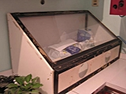
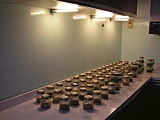

La natura è decisamente lungimirante, nulla è a caso come ad esempio fare in modo che il fiore dell’ orchidea produca una capsula con milioni di semi, sono tra i più minuscoli, visto la difficoltà che incontreranno poi a trovare le condizioni ottimali per poter germinare.

Le semine fatte in laboratorio alzano di molto la percentuale di successo nella germinazione dei semi, e un vivaio bene attrezzato è in grado di produrre migliaia di piantine da una capsula.

Tutto un altro discorso quando tutto ciò viene fatto in casa, però è talmente affascinante che vale comunque la pena di tentare.

Il modo in cui procedo, è il sunto di quello che ho appreso da coltivatori esperti, libri e… un pizzico di farina del mio sacco!!!

I terreni di coltura si possono preparare in due modi:

1) acquistando il prodotto pronto a cui si aggiungerà, l’ acqua distillata e l’ agar

2) preparando in casa la miscela degli elementi, che varia in base all’ esperienza e….alla fantasia del coltivatore!!!

Una delle differenze tra queste due possibilità è che i terreni commerciali hanno nelle loro formule degli "stabilizzanti" che fanno si che il composto rimanga tale e quale, mentre facendo le cose in casa a volte gli elementi fanno qualche strana reazione tra di loro, mandando a volte tutto all’ aria.

E stranamente usando lo stesso composto e gli stessi semi, alcune fiasche vengono bene ed altre fanno… fiasco!!!

Se si decide di preparare il terreno di cultura in casa, questa è una formula da me sperimentata :

1 lt di acqua distillata

1 gr di concime bilanciato, se possibile con poco azoto ureico

1 granello di nitrato di calcio

un goccino di chelato di ferro

20 gr di zucchero

8 gr di agar, quello professionale, altrimenti bisogna aumentare le dosi

un po’ più di mezza banana abbastanza matura, che andrà aggiunta per ultima

Se il terreno è di quelli già pronti bisogna controllare sul barattolo quanti gr per lt consigliano: se è sui 20 gr o più basta aggiungere l’ agar, se la dose è di pochi grammi vanno aggiunti anche 20 gr di zucchero per lt.

Metto tutti gli ingredienti, a parte l’ agar, nel frullatore e li mescolo più volte fino a quando sono ben sicura che si siano amalgamati bene.

Poi metto in un bagnomaria e quando l’ acqua inizia a bollire aggiungo l’ agar e continuo a mescolare per circa 15 minuti.

Precedentemente avrò preparato i barattoli (circa 15 da 100/150 gr circa, con il fondo piuttosto largo e il tappo a vite), e una volta tolto dal fuoco il terreno di coltura, procedo versando circa 1,5 cm di liquido per vasetto chiudendo man mano senza stringere troppo il tappo.

Nel frattempo metto un contagocce di vetro con l’ apertura piuttosto larga e avvolto nella stagnola a bollire per 15 minuti.

Preparo poi una pentola a pressione in questo modo: sul fondo metto 4 bulloni e sopra una retina a maglie strette e rigida, verso acqua fino a farla sfiorare la retina. Sistemo i vasetti ( ne stanno circa la metà) e da quando và in pressione la lascio per 12 minuti, facendola poi raffreddare (ci vorranno diverse ore) e procedere alla sterilizzazione dei restanti barattoli ai quali si aggiungeranno:

-un barattolino con dell’ acqua distillata

-un altro barattolino con una garza sterile

-due spatoline sottili e un paio di pinze sottili e lunghe che verranno avvolte nella stagnola

-un barattolino con una piccola dose di detersivo per i piatti.

Quando tutti i barattoli sono pronti procedo a sterilizzare la scatola (vedi la prima foto) con le maniche, in questo modo:cambio i guanti (quelli lunghi da veterinario), per sigillarli uso il nastro adesivo (quello per i pacchi)in uno spruzzino metto una soluzione di acqua distillata e candeggina al 10%,dò un’ abbondante spruzzata all’ interno della scatola e lascio lo spruzzino dentro, metto anche:i primi barattoli sterilizzati, una bottiglietta di alcool, un piccolo contenitore con una soluzione di candeggina al 30%

La spruzzatura và fatta 3 - 4 volte usando lo spruzzino attraverso i guanti. Ci vuole una mezz’ ora abbondante per avere un ambiente abbastanza sterile.

A questo punto introduco nella scatola tutto ciò che c’è nella pentola a pressione e il contagocce (lasciandolo nella stagnola), sigillo tutte le aperture della scatola, dò ancora una bella spruzzata e aspetto altri 15 minuti.

Infilando le mani nei guanti apro l’ alcool, i barattolini con la garza e l’ acqua, la stagnola con le pinze e le spatoline, un barattolo con il terreno di coltura.

È importante che la capsula con i semi sia ancora chiusa e in buone condizioni (né marcia, né troppo secca) e procedo in questo modo:

\- bagno la superficie con l’ alcool

\- bagno con la soluzione di candeggina al 30%

\- e un goccino di detersivo per i piatti.

A questo punto apro la capsula e, bagnando leggermente la spatolina nel detersivo, dentro al tappo di uno dei barattolini metto un goccino di acqua distillata e un po’ di semi e li allargo con la spatolina, poi con il contagocce assorbo un po’ della soluzione e la introduco delicatamente sul terreno. Metto pochi semi per barattolo, così si hanno più possibilità se qualche barattolo viene intaccato poi dai funghi.

A questo punto chiudo bene il barattolo e procedo allo stesso modo fino ad esaurimento dei semi.

Una volta finito, ripongo i barattoli in un posto tranquillo, luminoso e caldo e……………. incrocio tutte le dita!!!

