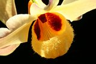
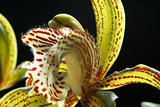
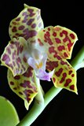
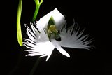
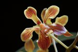
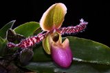

Era il 1987, quando tutto iniziò: la passione per le orchidee e quella per la fotografia.

Quell’anno mi avvicinai al Circolo Fotografico Scledense per partecipare al primo corso fotografico di base, mi piaceva moltissimo fotografare i fiori, ma non ne conoscevo la tecnica e soprattutto non avevo una reflex, nello stesso anno iniziai la ricerca sulle orchidee spontanee presenti sulle ”mie” montagne: macchina fotografica nuova nello zaino (una Canon Eos 600 ), cavalletto e, al mio fianco, mio marito ad accompagnarmi.

Nello stesso periodo acquistai pure la mia prima orchidea in un piccolo garden della zona: un Paphiopedilum insigne ( praticamente nel '87 le orchidee erano rarità sconosciute ), allora ne ero affascinata perché conoscevo il Cypripedium calceulus.

Nasce così il forte connubio tra “orchidee e fotografia”.

La forte passione fotografica supportata dall’aiuto dei soci del Circolo, mi portò a frequentare, negli anni, parecchi corsi man mano di livello sempre più avanzato, riuscendo così a perfezionare la tecnica e specializzarmi in macrofotografia.

Il mio principale obiettivo rimase sempre la ricerca delle orchidee spontanee della Val Leogra e della Val D’Astico, il tentativo era quello di riuscire ad ottenere dei “veri ritratti” in modo da valorizzare questi meravigliosi e straordinari fiori, ricerca che durò ben sei anni, una caccia fotografica attuata camminando in lungo e in largo per sentieri scoscesi e impervi durante quasi tutte le stagioni dell’anno, riuscendo a scoprire e fotografare ben 55 delle specie presenti.

Ancora oggi conservo più di una trentina di ingrandimenti in 20x30 (ingrandimenti che allora partecipavano ai concorsi fotografici) stampati su carta Cibachrome da diapositiva: la mitica Velvia a 50 iso, della Fujii dai colori insuperabili, altro che digitale di oggi (es. una diapositiva 24x36 millimetri conteneva 19.000 pixel) [ndr: valore teorico; attualmente una digicam superiore ai 5 mpx, purchè corredata di un ottimo obiettivo, supera di molto la controparte analogica in praticamente tutte le caratteristiche a parità d'ingrandimento].

Le affermazioni fotografiche in quegli anni non mancarono affatto, partecipavo ai concorsi fotografici provinciali e nazionali classificandomi a 3°, 2° e anche 1° posto e anzi, la soddisfazione non è venuta a mancare neppure ad un circuito internazionale organizzato dal Circolo Fotografico Scledense, quando inclusero tra il gruppo di autori, sei per la precisione, anche me, con la sorpresa poi di vedere menzionato il mio Portfolio fotografico composto di 4 foto su fiori.

Dopo parecchi anni di presenza assidua al Circolo Fotografico, decisi di avvicinarmi e iscrivermi all’associazione ATAO, appunto per la passione che conservo tutt’ora per le orchidee, sempre con la compagnia costante della macchina fotografica ormai da qualche anno passata digitale, solo cosi ritengo che il connubio sia perfetto e completo.

Quale consiglio per fare belle foto? Difficile darlo in maniera generica, ormai ci sono macchine fotografiche compatte altamente sofisticate che riescono a dare soddisfazioni anche a chi non ha una conoscenza approfondita, anche con una compatta avvalendosi di un uso corretto dei vari automatismi e programmi dedicati permette di ottenere risultati sopra la media: basta inquadrare, schiacciare il pulsante e la foto è fatta! Tutto si è semplificato alla facilità estrema!

La mia esperienza in tutti questi anni?

Sono contenta del bel bagaglio di conoscenze e sono convinta che non è merito di una macchina fotografica, costosa, super sofisticata, ultraprofessionale, che si fa la foto “bella” ma serve la sensibilità (artistica e culturale) della persona che le stà dietro, per scegliere cosa si vuole valorizzare e quale chiave di lettura e impatto visivo si vuole comunicare.

L’ inquadratura, l’importanza della luce, la composizione delle forme e dei colori, lo sfondo per valorizzare il soggetto , un particolare magari che difficilmente a prima vista non si nota (e che poi ingrandendo permette di esplorare un mondo meraviglioso): tutti questi accorgimenti rendono una foto “curata”

Ma ci vuole poi la passione (sicuramente tanta) per “riuscire”, e questo lo ottiene chi ama e coltiva le orchidee: non può non fotografarle e ignorarle quando sono in fiore e non pensare che poi la foto rimanga semplicemente un ricordo.

No, io credo sia molto di più, fotografarle non è solo un modo per fermarle nel tempo: è il fermarle in un'idea.

