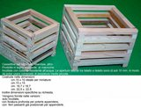
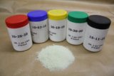
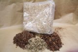
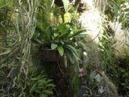
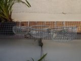

## Materiale a diposizione dei soci

In questa sezione, i soci possono trovare materiali scelti e adatti alla coltivazione delle orchidee, pubblicazioni dell'ATAO, piante che i soci stessi rendono disponibili allo scambio e quant'altro sia ritenuto un valido aiuto per il mostro hobby.

Qualsiasi richiesta va inoltrata alla segreteria (sezione “CONTATTI”) specificando tipologia e quantità di materiale richiesto.

## Cestelli

Probabilmente sono il “contenitore principe” per la coltivazione delle orchidee permettendo la libera circolazione dell'aria e lo sgrondo immediato dell'acqua mantenendo nel contempo un elevato grado di umidità alle radici.

Altre indicazioni sono visibili direttamente nella foto allegata.

## Concime

Sono disponibili i seguenti titoli di concime con microelementi:

20-20-20 (Disponibilità n° 70)

10-52-10 (Disponibilità n° 10)

30-10-10 (Esaurito)

10-30-20 (Disponibilità n° 83)

15-11-29 (Disponibilità n° 15)

I barattoli sono da gr. 250

## Sfagno e corteccia

Sfagno bianco di torbiera a fibra lunga in pacchi da:

150gr./7,5lt. (Disponibilità n°)

1kg/50lt. (Disponibilità n°)

Corteccia di pino sugherosa specifica per la coltivazione delle orchidee in sacchi da 12kg./80lt. Disponibile in 2 pezzature:

fine (Disponibilità n°)

media (Disponibilità n°)

## Canestri

Per le più delicate piccole piante si possono utilizzare questi comodi cestelli in ferro zincato , diametro 8, 10, 12 cm, da riempire col composto preferito.

Dispongono di attacchi per poterli appendere.

