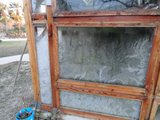
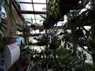

Ogni 20 anni circa il freddo colpisce forte, molto forte... fuori però!

Dentro la serra, la temperatura è a livelli ancora accettabili nonostante si raggiungano gli 8° C a soli 2 centimetri di distanza dai vetri ghiacciati.

Belle le fioriture delle orchidee nella serra e belli i fiori di ghiaccio sui vetri finchè non fanno male.

(febbraio del 2012)

