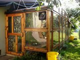
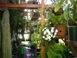
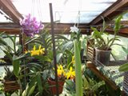

La nostra è una piccola serra dove sperimentiamo la coltivazione di Cattleya, Vanda e Masdevallia.

Non utilizziamo il fog perché tentiamo di avvicinarci il più possibile all’ambiente tropicale. Per ottenere questa condizione, facciamo sì che l’umidità arrivi dal pavimento:in particolare, di notte raggiunge l' 85-100% e di giorno il 60%; qualora dovesse scendere sotto il 45% entra in funzione un umidificatore ad ultrasuoni.Ci aiutano moltissimo le felci piantate a terra per mantenere l’umidità e bilanciare la temperatura.

A volte, in particolare d’estate, simuliamo gli acquazzoni tropicali irrorando oltre 200 litri d’acqua nebulizzata e poi lasciamo asciugare.

Nel periodo estivo entra in funzione un cooling a riciclo d’acqua che mantiene la temperatura ai 30, 32 gradi massimi.

Volendo, potremmo mantenerla anche più bassa, ma avendo avuto esperienza diretta dell'ambiente tropicale, sappiamo che le temperature diurne sono ben più alte.

Le piante vengono concimate alternando a caso le bilanciature del concime, ma mantenendo le dosi, la temperatura invernale ad altezza di busto non scende sotto i 14 gradi, mentre a pavimento abbiamo tra gli 8 e 10 gradi.

