## Afidi

Noti anche come pidocchi delle piante, si alimentano succhiando la linfa ed emettono come escremento una sostanza zuccherina (“melata”), che attira in particolare le formiche, a volte esse stesse veicoli di afidi da pianta a pianta. Sulla melata si possono insediare funghi che generano antiestetiche fumaggini, talora dannose per la pianta. Nelle orchidee le parti più colpite sono gli steli fiorali e i boccioli, talvolta anche i nuovi getti. Per la lotta, si utilizzano insetticidi specifici, meglio se ad azione sistemica.

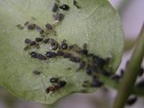

## Cocciniglie

Di varie forme, a scudetto o cotonose, si alimentano anch’esse della linfa, ma tendono a colonizzare l’intera pianta, arrivando, in alcune specie, a bloccarne lo sviluppo, predisponendola inoltre agli attacchi fungini. Annidandosi spesso in punti nascosti, come le ascelle fogliari, le brattee secche che avvolgono le vegetazioni mature, i rizomi e in alcuni casi anche le radici all’interno del vaso, possono sfuggire a un’ispezione poco attenta. La lotta contro questi temibili parassiti può avvalersi di prodotti tradizionali come gli esteri fosforici o gli oli minerali, o di insetticidi di nuova generazione, sistemici o meno. È importante verificare l’efficacia dei prodotti, variarli e ripetere più volte i trattamenti nel corso dell’anno a intervalli regolari, in quanto un singolo trattamento difficilmente è in grado di eliminare tutti gli insetti.

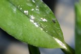

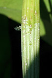

## Chiocciole e Lumache

Molluschi attivi prevalentemente di notte, si nutrono delle parti più tenere della pianta, dalle radici (sono buoni scavatori in terreni soffici), ai nuovi germogli, dagli steli fiorali, ai boccioli. Difficile eliminarle del tutto, ma si possono tenere sotto controllo distribuendo sulla superficie dei vasi o tra i vasi stessi delle esche a base di metaldeide (eventualmente ridotta a polvere in modo che possa penetrare tra la corteccia in profondità nel vaso) o fosfato ferrico. Si possono anche attirare le limacce con dei bassi contenitori pieni di birra, di cui sono ghiotte e in cui finiscono per annegare.

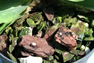

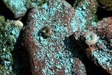

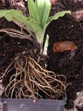

## Acari

Rappresentati perlopiù dal cosiddetto ragnetto rosso, poco visibile a occhio nudo, si nutrono del contenuto delle cellule e stazionano prevalentemente sulla pagina inferiore delle foglie, generalmente a lamina sottile. Sono un problema di secondaria importanza in ambienti con umidità elevata, possono divenire temibili su piante coltivate all’aperto o in ambienti asciutti. La lotta si basa sull’utilizzo ripetuto a intervalli brevi di acaricidi specifici, variando i principi attivi per evitare l’insorgere di forme di resistenza.

## Phytium

Noto anche come marciume nero (talvolta brunastro), determina marcescenza dei fusti o delle nuove vegetazioni; le parti colpite acquistano una consistenza acquosa e, se rotte, emettono un caratteristico odore acre. L’infezione è favorita da bagnature prolungate e ristagno di acqua all’ascella delle foglie e nelle nuove vegetazioni, specialmente (ma non solo) se associate a temperature basse. Se il fungo attacca il fusto di piante monopodiali (es. Phalaenopsis) le foglie cadono ancora verdi, con la sola parte basale ingiallita. Essendo questo fungo molto aggressivo e con uno sviluppo molto rapido la cura dev’essere tempestiva per sperare di salvare la pianta . Il principio attivo d’elezione è il propamocarb, efficacissimo sia come prevenzione sia come cura.

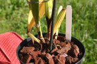

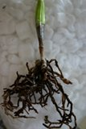

## Botrytis

Infezione fungina che colpisce prevalentemente i fiori in condizioni di prolungata bagnatura, associata a temperature relativamente basse. Si elimina con facilità favorendo il movimento d’aria tra le piante in modo che asciughino in breve tempo dopo le bagnature o le nebulizzazioni. In genere sulle orchidee non viene trattata con fungicidi.

## Macchie fogliari

Di vario aspetto, sono spesso causate da funghi appartenenti a generi imparentati tra loro (Alternaria, Colletotrichium ecc.). Tendono a determinare la caduta delle foglie colpite e, se non curate, un generale indebolimento della pianta, che può anche morire; talvolta si tratta di affezioni molto contagiose, in altri casi colpiscono solo una o poche piante, lasciando quelle vicine totalmente indenni. La cura si basa sull’uso per lunghi periodi (molti mesi), a intervalli regolari (8-15 giorni), di fungicidi endoterapici (sistemici, citotropici) ad azione specifica, associati a prodotti ad azione di contatto, utilizzando miscele degli stessi: data la molteplicità degli agenti patogeni ed essendo i sintomi spesso molto simili, non sempre si può risalire esattamente al fungo responsabile dell’infezione. Una volta eradicata la patologia, bisogna comunque insistere a intervalli meno frequenti per prevenire l’infezione da parte delle spore fungine che rimangono nell’ambiente.

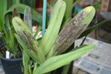

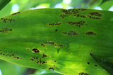

## Batteriosi

Poco frequenti in generale, assumono particolare importanza solo nei Paphiopedilum, nei quali uno specifico batterio può determinare marciumi del colletto e spesso la morte della pianta. La cura consiste nel rimuovere la parte colpita o distribuire antibiotici per uso topico in polvere (il cui uso non sarebbe però ammesso sulle piante).

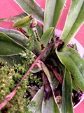

## Virosi

Non frequenti, determinano vari sintomi, tra cui i più diffusi sono maculature o striature clorotiche o necrotiche delle foglie (confondibili con altre affezioni o fisiopatie) e striature di diverso colore nei fiori, questi ultimi possono presentarsi con deformazioni a carico dei petali. A volte le piante colpite da virus possono non fiorire regolarmente.

Non curabili con i mezzi a disposizione del coltivatore amatoriale, l’unico rimedio è la distruzione con il fuoco delle piante colpite.

Da notare che storicamente, soprattutto in Giappone, le piante colpite da virus erano molto ricercate proprio in ragione della “bellezza aggiunta” del fogliame.

Come per altre specie di piante, alcuni esemplari di orchidee subiscono a causa dei virus modifiche genetiche trasmissibili: avremo piante con foglie nettamente striate in bianco o giallo pur essendo le stesse assolutamente sane ed esenti da virus.

## Bruciature da calore

L'esposizione ai raggi solari, in special modo attraverso i vetri senza che ci sia ricambio d'aria e quindi con la formazione di sacche di calore tra le piante e i vetri della serra o finestra, porta spesso all'ustione dei tessuti vegetali.

La stessa situazione si può presentare anche portando all'aperto le piante che hanno passato in casa parte del tempo e non hanno ancora sviluppato protezione alle radiazioni solari o che vengano esposte al sole con le foglie bagnate, le gocce d'acqua possono formare delle lenti naturali che concentrano i raggi luminosi sulla lamina fogliare.

Ne vanno soggette un po' tutte le piante ma in particolar modo quelle che vivono naturalmente in situazione di penombra. I tessuti morti tendono a seccare e costituiscono un danno soprattutto estetico se non estesi a tutta la pianta, nel caso ne siano colpite le foglie, a volte, ne segue la caduta e un naturale lento ricambio.

E' auspicabile un controllo delle situazioni ambientali di coltivazione al fine di evitare il ripetersi del danno e trattamenti ricostituenti che possano aiutare la pianta a generare nuovi tessuti.

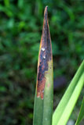

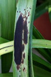

## Bruciature da freddo

Similmente ai danni causati dal calore, anche il freddo, se eccessivo può portare a danneggiamenti più o meno seri, fino al totale congelamento con conseguente morte della pianta. In questo caso i soggetti più predisposti sono le piante con tessuti carnosi ricchi d'acqua.

Le parti necrotizzate delle foglie o fiori, formano macchie scure e acquose che col tempo tenderanno a seccare.

Diversamente dalle scottature, se persistono condizioni di freddo è facile l'insorgere di malattie di tipo fungino che trovano in quei tessuti l'ambiente adatto per svilupparsi.

E' necessario un ripristino rapido delle condizioni di temperatura entro i limiti di coltivazione, l'applicare dei trattamenti fungicidi preventivi e anche in questo caso, dei trattamenti di vitamina E che aiutano la pianta a superare parte del danno.

## Oziorrinco

Piccolo insetto nerastro (coleottero curculionide) che misura all'incirca 5/7 mm.

Di giorno si nasconde dentro i vasi ed esce di notte risalendo i fusti delle piante per farsi una scorpacciata con le foglie più tenere.

I danni da oziorrinco si riconoscono dai classici morsi a forma di mezzaluna che arrecano alle foglie e sono, più che altro, di tipo “estetico”, purchè gli insetti non si presentino in massa.

E' uno degli insetti più insidiosi in giardino, difficilissimo da combattere perchè spesso elusivo se non quando il danno è ormai già fatto.

E' una guerra sempre aperta.

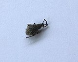

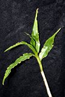
