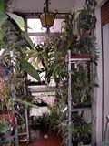
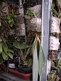
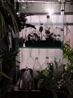

Faccio una piccola fondamentale premessa per capire quanto scriverò in seguito: ritengo, come molti, che sia importante considerare il luogo in cui vengono coltivate le proprie piante: la sua luce, la sua umidità, la sua temperatura sono i soliti parametri generali ma che si comportano in modo così peculiare solo in quella situazione locale.

Il mio luogo di coltivazione è una piccola veranda, vetrata su 2 lati, ottenuta chiudendo le 2 pareti di una terrazza coperta rivolta a sud - sud/ovest: riceve luce quasi per tutto il giorno e tutto l'anno, in estate e nei giorni più assolati una tenda esterna con sensore provvede all'ombreggiamento.

La veranda , essendo parte integrante degli ambienti della casa, non gode della possibilità di "controllo" dell'umidità ambientale, ad ogni modo ho fatto delle verifiche continue per 2 anni consecutivi e ho constatato che l'umidità si mantiene sempre su valori intorno al 60-70% con poche fluttuazioni nel corso dell'anno; a parte lasciare l'acqua nei sottovasi colmi d'argilla espansa e una spruzzata d'acqua giornaliera alle piante (o 2 in estate), altro non faccio.

La veranda non è riscaldata ma poichè confina con la cucina ed il soggiorno (e con i quali comunica attraverso 2 porte e una finestra) riceve da questi, in inverno, il riscaldamento necessario (le porte e la finestra sono sempre aperte). I serramenti esterni sono in alluminio con doppio vetro ma ho provveduto ad aggiungere un ulteriore strato in "vetro sintetico" con indubbi vantaggi per l'isolamento generale.

Il ricircolo d'aria... non c'è. Non c'è nel senso che in estate le finestre della veranda rimangono sempre aperte mentre in inverno si aprono le finestre negli altri ambienti della casa o direttamente la porta a vetri della veranda per accedere al terrazzo esterno.

Per la restante coltivazione generale (concimazioni - 1 volta a settimana-, annaffiature, trattamenti fitosanitari ecc) non adotto particolari sistemi.

Da metà aprile - inizi di maggio porto gran parte delle piante all'aperto sotto una pergola di kiwi orientata ad est, le riporto in casa verso la metà di ottobre.

Coltivo la maggior parte delle piante, soprattutto quelle grandi, in vasi di plastica, i soliti vasi neri.. e qualcuno di trasparente ma senza pretese.

Altre, per forza di cose, sono sistemate in cestello di legno o di plastica. Sono orchidee che producono i fiori verso il basso: solitamente le Stanhopeine ma ho notato che apprezzano molto i cestelli in legno anche i Bulbophyllum non fosse altro perchè si abbarbicano con i loro invadenti rizomi attorno al vaso senza rischiare quindi di doverli rinvasare spesso o doverli staccare dai vasi vicini.

Alcune orchidee sono sistemate su zattere di sughero o pezzi di tronco di vite, a radice nuda o appena su un leggero strato di sfagno muschio generico: sono orchidee con foglie carnose e radici grosse o molto spugnose, insomma piante che non sono schizzinose riguardo a possibili periodi di "siccità": Phalaenopsis, Aerangis, Scuticaria, Dendrobium, Oncidium, ecc...

Il bello viene con alcune orchidee che, o non hanno importanti strutture di riserva idrica, o hanno radici molto sottili o non sopportano periodi di prolungata siccità.

Nel mio caso, questa "categoria" di piante deve ricevere la solita bagnatura giornaliera, ma non deve asciugarsi troppo in fretta come accade a quelle che sono su tronchetto, purtroppo non devono nemmeno restare bagnate per troppo tempo perchè hanno la sgradevole tendenza a marcire o ad ammalarsi a causa di attacchi fungini.

Tempo fa risolsi il problema molto semplicemente avvolgendo parte della zattera e le radici con la pellicola autoaderente usata in cucina per conservare i cibi; in un certo senso ho creato una "serra" solo attorno alle radici.

La fasciatura ovviamente non dev'essere troppo stretta, deve consentire un leggero ricircolo d'aria ma essere sufficientemente tesa da trattenere la pianta come se fosse lo spago che normalmente si usa per fissarle al supporto.

Questo permette alle radici sottili di rimanere bagnate per qualche ora e poi asciugarsi completamente fino al giorno seguente.

Un'ulteriore "perfezionamento" arriva dall'applicare il precedente sistema ad un'idea che ha avuto Danilo Slaviero: anzichè far abbarbicare una pianta ad una zattera di corteccia, Danilo ha creato una scatola in rete plastificata ( la rete con maglia quadrata da 1 cm x 1 cm... tanto per dare l'idea, le dimensioni della scatola finale sono "a degustibus") e l'ha riempita con la solita corteccia per orchidee, quindi la pianta viene attaccata su una delle superfici ( ma anche sopra o sotto a seconda della specie).

Evidentemente, in una struttura siffatta, l'aria viene rallentata negli spazi tra i vari pezzi di corteccia preservando quindi una maggiore umidità dopo le annaffiature: cosa che sembra assai gradita alle piante che sviluppano di conseguenza un notevole apparato radicale.

A questa struttura ho applicato la pellicola con le stesse modalità della versione precedente, le piante più delicate hanno apprezzato moltissimo!.. alcune malridotte perchè già stressate per vari motivi si sono riprese con velocità fulminea e altre che notoriamente sono poco propense a produrre radici lungo il fusto, invece hanno deciso di cambiare abitudine.

Ho dovuto affrontare un'altra situazione completamente differente quando mi sono dedicato alla coltivazione delle "orchidee gioiello", Ludisia (ma questa specie in genere è già facile di suo), Macodes, Malaxis, Goodyera e altre.

Sono tutte piante che in natura crescono nel sottobosco umidissimo o vicino a ruscelli completamente attorniate dal muschio ( in alcune località asiatiche le chiamano infatti "orchidee del muschio"): in ogni caso crescono in situazioni impossibili da ricreare normalmente nella mia condizione.

In questo caso ho provveduto a inglobare ogni singolo vaso in un contenitore trasparente.

Nella fattispecie per i piccoli e medi vasi ho utilizzato le bottiglie in plastica trasparente delle bibite tagliandoli in vari modi: ho tolto il fondo per poterli appoggiare sopra il bordo del vaso o fino in fondo come fossero una campana, ho tagliato la parte superiore per poterci infilare dentro il vaso.

In ogni caso va sempre svitato il tappo e vanno creati dei fori d'aerazione nella parte basale in modo che sia sempre possibile un leggero ricircolo d'aria.

Se il substrato è ben fatto si svilupperà anche il muschio che creerà un folto "prato".. anche troppo a volte!

Le bagnature sono facili: si spruzza l'acqua direttamente dall'imboccatura della bottiglia e il muschio dovrebbe conservare le goccioline d'acqua per tutte le 24 ore successive.

Ovviamente non tutte le piante apprezzano la mia veranda, alcune specie o interi generi proprio non ne vogliono sapere di sopravvivere, sono piante che, per quanto al momento mi spiaccia, non ho intenzione di tornare a coltivare; per il resto sono abbastanza contento dei risultati ottenuti.

