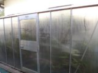
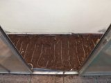
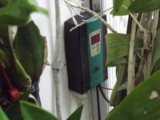
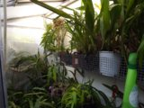

Nel 2007 mi sono posto il problema di come far svernare le piante da serra fredda con una soluzione che fosse più efficace del metterli sotto il bancone in quella intermedia/calda o di stipare le piante fra vani scale o tra finestre e controfinestre.

Il tutto per dare una sistemazione più consona alle piante di Cymbidium ormai fuori stazza ma anche per ampliare la collezione alle piante meno esigenti in fatto di temperature.

Di seguito le mie considerazioni fatte allora che spero possano essere utili a chi abbia voglia di dedicarsi più specificamente alle “orchidee da serra fredda”.

Non è complicato realizzare una struttura adatta allo scopo e comprarla non è particolarmente esoso, l’unico consiglio che mi sento di poter dare è di preferire una struttura che si appoggi a un lato della casa, meglio ovviamente la parete sud dell’edificio, e che il lato della serra “sostituito” dal muro corrisponda a quello lungo.

In questo modo i vantaggi sono notevoli:

1) considerando che le dimensioni saranno modeste, si dà solidità alla serra.

2) si risparmia sul materiale di tamponamento e si evita dispersione termica, se è il lato nord della serra (questo in ogni caso) mantenendo la massima esposizione solare possibile.

Mi sono affidato ad una ditta tedesca, la “Beckmann” di cui è concessionaria in Italia la “Serre e giardini”, che vendeva kit prefabbricati da montare da soli: una soluzione intermedia tra comprare “chiavi in mano” e “auto-costruirsi” la serra.

Per la struttura, in alluminio di 384 cm x 84 cm, il prezzo ora (novembre 2012) è circa 980 euro.

Come materiale di tamponamento viene fornito un semplice foglio di policarbonato da 6mm.

Come già detto, qualsiasi struttura, anche solo legno e nylon, poteva andare bene. La cosa che più mi arrovellava era come riscaldarla ad un prezzo ragionevole.

La soluzione l’ho trovata nello stesso catalogo della “Beckmann”: una cavo riscaldante di 25m usato per riscaldare i semenzai tra i 12 e gli 8 gradi da 320 watt (circa 80€), abbinato ad un termostato digitale (circa 70€).

Ogni autunno sul pavimento della serra, che è il marciapiede della casa, distendo un foglio plastico che ricopro di terriccio; immergo nel terriccio il cavo riscaldante disposto a serpentina. L’effetto è quello di un riscaldamento a pavimento.

Ormai la serra sta per affrontare il suo sesto inverno (2006/7 - 2012/13) e, Maya permettendo, sono certo del risultato positivo: in termini di sopravvivenza delle piante, avendo superato il dicembre 2009 a -14° esterni con un accettabile + 1° all’interno che non ha arrecato danni alle piante tenute in quell’occasione all’asciutto da settimane.

In termini economici, prendendo come esempio il bimestre gennaio-febbraio 2012, la spesa stimata si è aggirata sui 70€. Risultato che considero accettabile e migliorabile, per esempio, aumentando l’isolamento con spessori maggiori del materiale di tamponamento.

