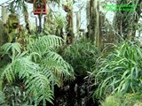
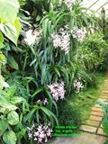
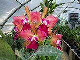
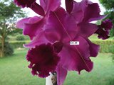
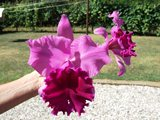
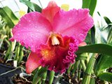
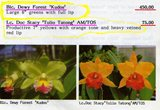
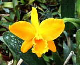
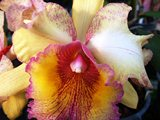

Tutto ebbe inizio un giorno del secolo scorso (correva l'anno 1971 e correvano pure i miei primi 19 anni) con una serra autocostruita per fornire riparo alle verdure dell’orto: quella dei pomodori ed insalata per intenderci, ma era talmente bella che la ritenni sprecata per metterci degli ortaggi; così l'anno successivo decisi di cambiare tipo di coltivazione.

Naturalmente in una cornice dorata non puoi che mettere un quadro d'autore così iniziai la coltivazione dei primi Cymbidium, piante che avevo incontrato nei miei viaggi in Liguria, lì trovai pure anche un gruppo storico di commercianti ed appassionati da cui imparare i trucchi di “bottega” e, tra esperimenti, successi ed insuccessi, la mia passione sta per compiere i suoi primi quarant’anni.

La prima veraserra ( mt 20x8, non quella dell’orto) durò un paio d’anni, causa una tromba d’aria la dovetti sostituire con una nuova di 20m x 8m.

Tale spazio non si dimostrò certo esagerato perché la fortuna o "sfiga" volle che avessi un collega di reparto che effettuava import/export nel settore edile con il centro America e con l’Africa, in particolare con il fratello console in Madagascar, quindi una fonte preziosa per la mia iniziale collezione.

Non solo!

Un certo “Sig. G” di Trieste, come professione, importava per la vendita piante da ogni parte del mondo (naturalmente provenienti da raccolte in foresta) e questa fu un’altra preziosa importante fonte d'approvvigionamento.

Erano indubbiamente altri anni.

Ricordo inoltre dalla Liguria: la Valco, Giorgi, Feltri, Sommariva e altre piccole aziende da cui recuperare orchidee. Il Criveller da Ostia, il comm. Dalla Rosa e il Gallamini da Forlì.

Non solo!

Durante gli anni ‘80 spesi follie per l’acquisto di piante: divisioni di nuove varietàdi ibrididi Cattleya, diCymbidiume di specie botaniche; ricordo aziende come l’Hausermann della Florida, la Green Orchids Taiwan e altre aziende inglesi e australiane.

Fu così che dovetti costruire altre due serre per un totale di circa 500 mq.

Tra l’anno '85'86 venne la voglia di creare degli ibridi di Cattleya.

tutti i giovani che scalpitano animati dallo spirito della novità, provai anche questa esperienza.

Grazie alle varietà stupende e pluripremiate che possedevo ed all'amicizia con il dott. Galamini di Lugo di Romagna (il quale aveva un laboratorio professionale per semine di Cattleya che eseguiva già da anni per sé ), ho incrociato gran parte delle mie piante (A con B, B con A, A con C, C con A, B con C e così via) fino ad avere un centinaio di bacche.

Forse un poco “naif” come approccio ed in effetti la cosa al momento del rinvaso delle giovani piantine mi mandò in crisi causa la debordante quantità di piantine ottenute.

Però,dopo anni di attesa e sacrifici, la costanza mi ha premiato.

Credo di avere una collezione stupenda, forse unica per il numero di varietà e bellezza, almeno per me.

