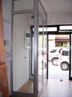
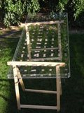
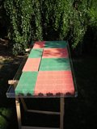
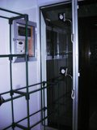
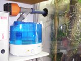
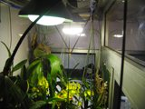
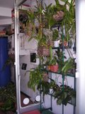
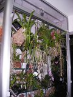
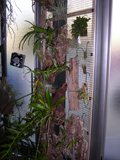

Giovanni S. ha costruito in casa un ricovero invernale per le sue orchidee: una parete interna della sua casa è stata riservata a tal scopo, ciò non toglie che, in futuro, possa trasformarsi in un orchidario permanente per le piante più delicate.

La struttura non è certamente “casalinga” e presuppone l'apporto di manodopera specializzata, almeno per la parte strutturale; Giovanni ha però provveduto a “personalizzare e finalizzare” il tutto. A seguire una veloce descrizione , con tanto di spese generiche, giusto per dare un'idea dell'impegno sostenuto.

STRUTTURA

Ho fatto costruire la struttura in alluminio ( 1700 € ) alle dimensioni desiderate e mi son fatto tagliare del policarbonato per isolare il muro e il soffitto ( 400 € ) al fine di evitare problemi d'umidità con i muri della casa: la struttura è così un corpo autonomo.

Ho fatto fare un telaio d'acciaio per fissare le lampade e per l'impianto di irrigazione a pioggia ( 30 € ).

Sul pavimento ho posato delle piastre di plastica da giardino per tenere sollevate le piante dallo stesso ( 8 € al pezzo ) e ho comprato 2 scaffalature tipo serra da balcone della "Verdemax" ( 10 € ) come scaffalatura per i vasi.

Per appendere tutte le zattere ho comprato 2 listelli di legno 25 x 25 con cui ho fatto un telaio e fissato una rete metallica plastificata verde (maglia da cm 1 x 1) ( 9 € ).

SISTEMI DI CONTROLLO AMBIENTALE

Per far funzionare le apparecchiature ( lampade, ventilatori e aspiratore ) ho riutilizzato 3 orologi temporizzatori che già avevo, ho recuperato da un carrello portavivande dismesso da una pizzeria un termometro digitale con sonda per tenere d'occhio le temperature, ho montato un fine-corsa sulla porta per togliere corrente a tutto l'interno tranne l'illuminazione ( 5 € ) e ho montato un interruttore di sicurezza magnetotermico da 1 milliampere ( 80 € ).

ARIA

Ho comprato un aspiratore da parete per aspirare l'aria dell'interno ed espellerla per dare riciclo alla serra ( 30 € ), 4 ventole da raffreddamento per sistemi elettrici tipo schede elettroniche, ecc.... ( 8 € l'una ) che servono al ricircolo interno.

LUCE

Ho montato 2 lampade ai vapori di mercurio ( 60 € l'una con accenditore ).

TEMPERATURA

L'orchidario è montato dentro casa e beneficia automaticamente della temperatura interna: non è installato alcun sistema di riscaldamento dedicato. In più, l'accensione delle lampade contribuisce ad innalzare la temperatura all'interno dell'orchidario (circa 22°C di giorno mentre la notte scende verso i 16 / 17°C).

ACQUA

Parte dell'annaffiatura avviene in maniera automatica con degli irrigatori, questi ultimi e il tubo per aria compressa sono stati acquistati al briko ( 15 € ), al tutto viene affiancato un umidificatore (acquistato in ebay per 30 € ).

Ho fissato con del silicone un cavetto riscaldante sul fondo della serra; non per riscaldare l'ambiente, come prima accennato, ma per far evaporare i ristagni d'acqua d'irrigazione ( 30 € ).

CONCLUSIONI

Con tutto questo materiale ho allestito l'orchidario.

Per il momento sembra funzionare bene e finora sulle piante non ho riscontrato problemi di alcun genere.

A presto; G.S.

