L'Associazione partecipa alla stesura di articoli che trovano pubblicazione su riviste ad ampia diffusione, alla consulenza per la scrittura di libri e a servizi video relativi alle nostre esposizioni.

L'ATAO ha all'attivo la pubblicazione del libro [“Orchidee – cure colturali, generi e specie”, editore Giunti Demetra](http://www.giuntistore.it/customer/product.php?productid=12330&cat=541);

Esce inoltre, in forma discontinua, con un articolo sulla rivista [altrostile](http://issuu.com/altrostile)

Per i video riferirsi alla sezione “Cronache”.

### Articoli pubblicati nel 2016

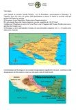

- [File stampabile-pdf](/documenti/relazione_nicaragua.pdf)

### Articoli pubblicati in ”Altrostile” annata 2014

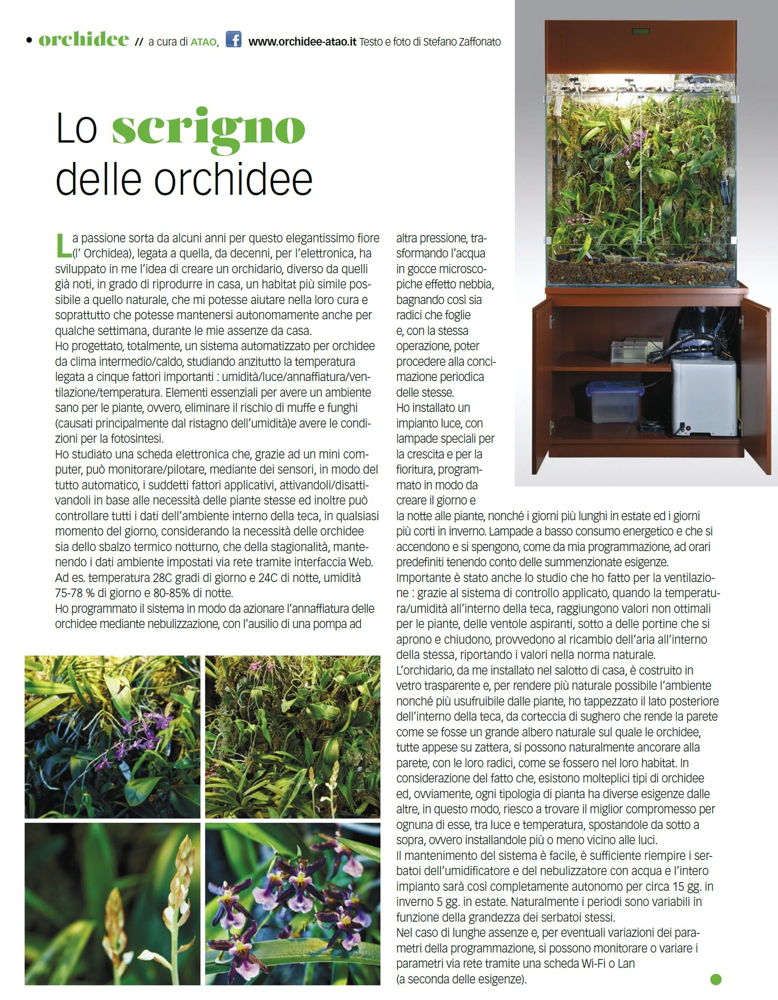

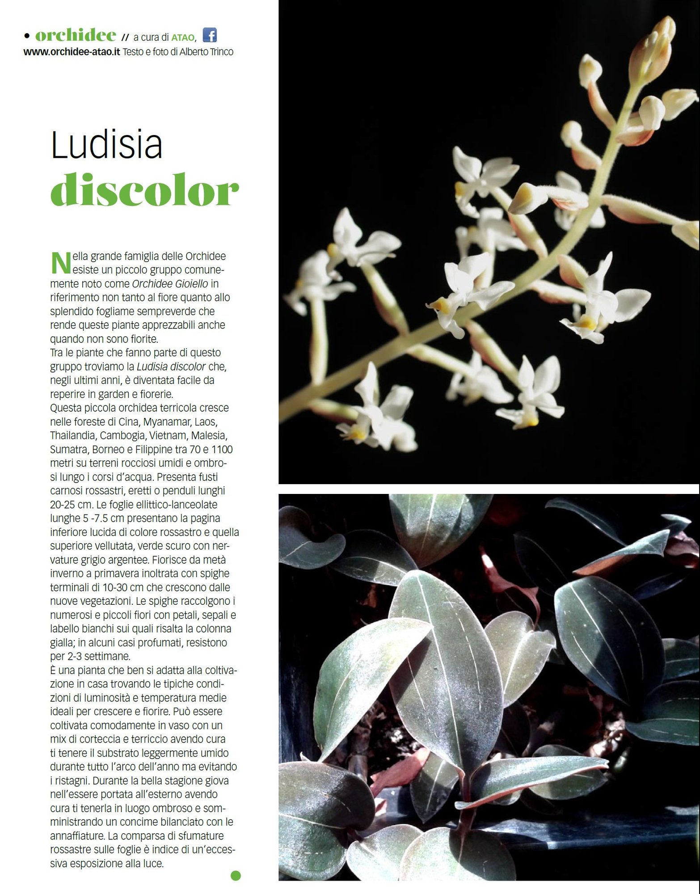

- [File stampabile-pdf](/documenti/altrostile_mag-2014.pdf)
- [File stampabile-pdf](/documenti/altrostile_giu-2014.pdf)

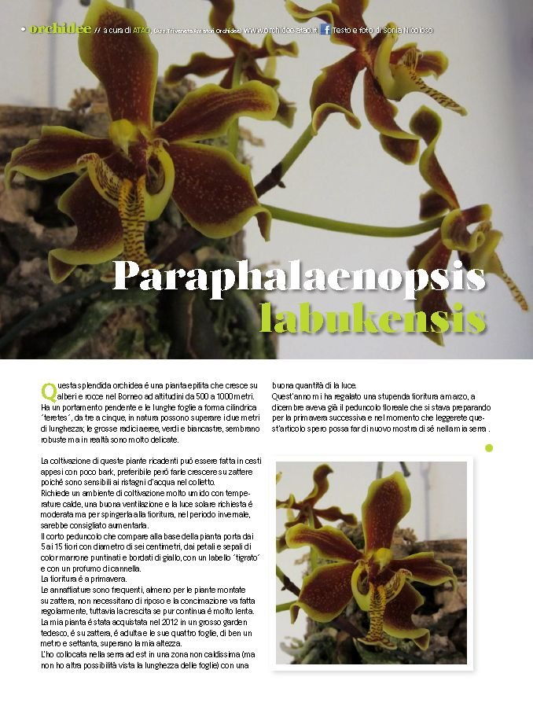

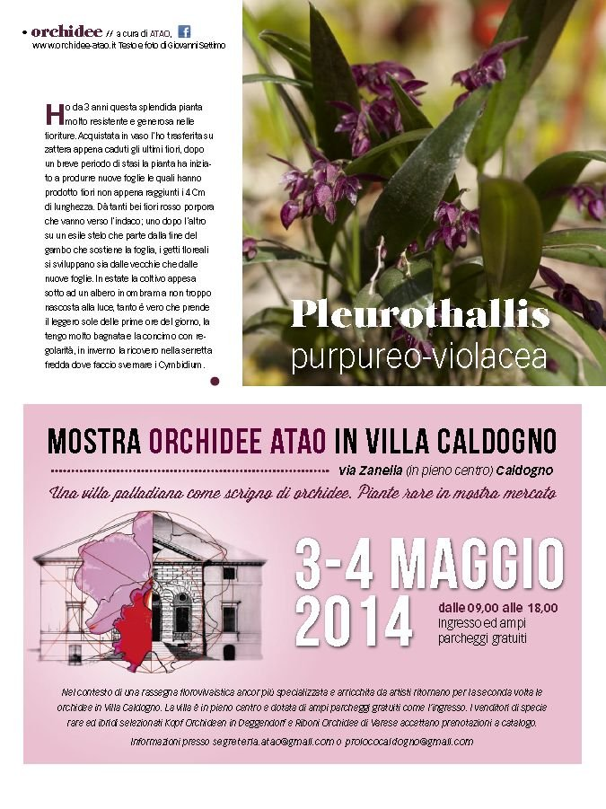

- [File stampabile-pdf](/documenti/altrostile_mar-2014.pdf)
- [File stampabile-pdf](/documenti/altrostile_apr-2014.pdf)

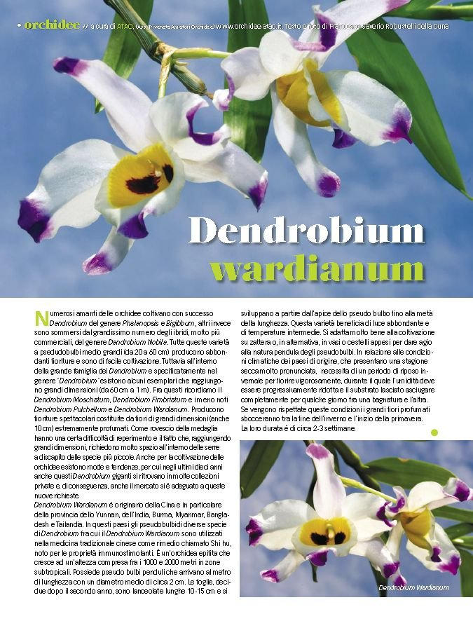

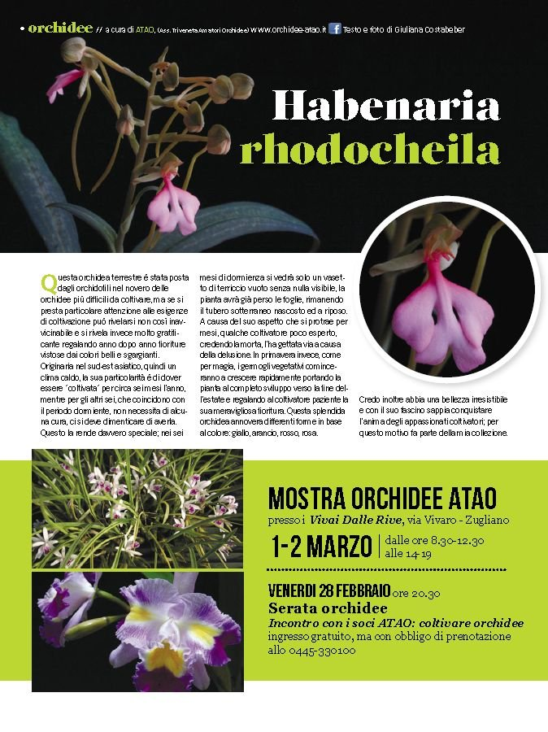

- [File stampabile-pdf](/documenti/altrostile_gen-2014.pdf)
- [File stampabile-pdf](/documenti/altrostile_feb-2014.pdf)

### Articoli pubblicati in “ViaVai”-”Altrostile” annata 2013

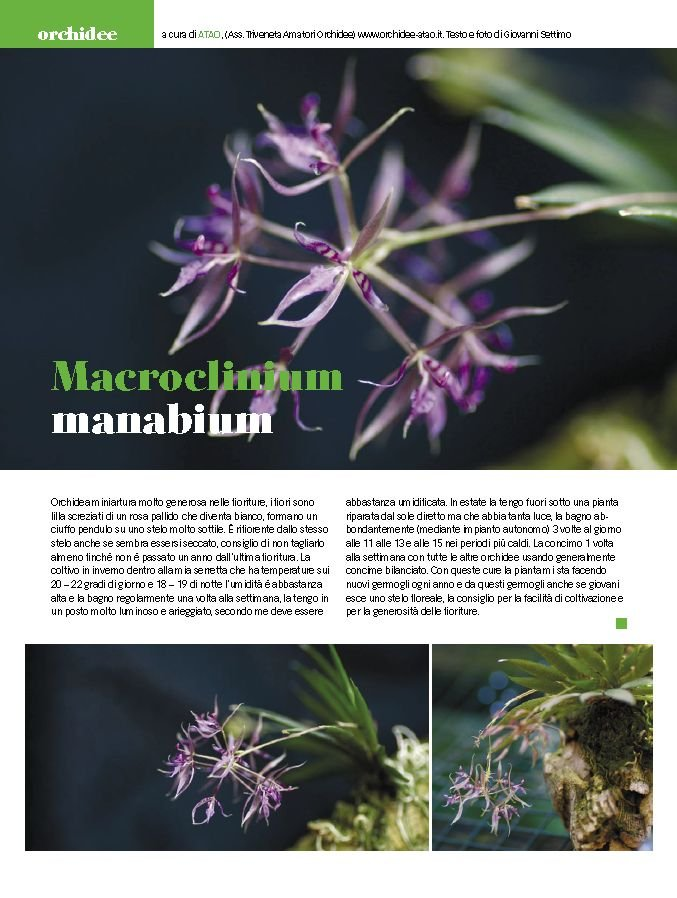

- [File stampabile-pdf](/documenti/altrostile_dic-2013.pdf)

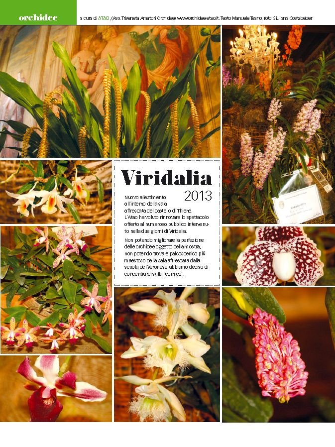

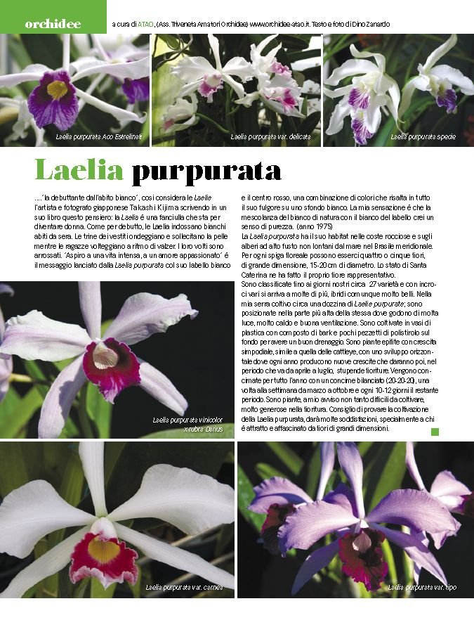

- [File stampabile-pdf (ottobre 2013)](/documenti/altrostile_ott-2013.pdf)
- [File stampabile-pdf (novembre 2013)](/documenti/altrostile_nov-2013.pdf)

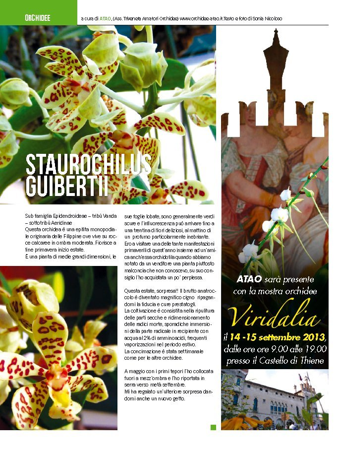

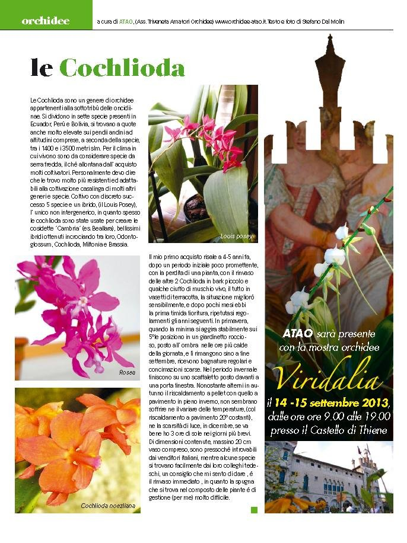

- [File stampabile-pdf](/documenti/n167-ago13.pdf)
- [File stampabile-pdf](/documenti/altrostile_set-2013.pdf)

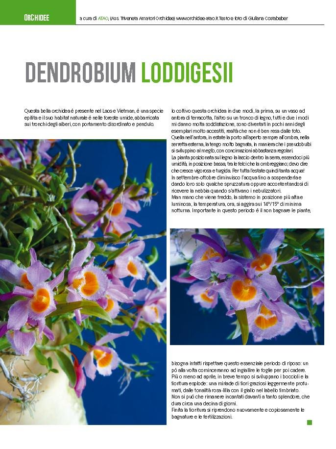

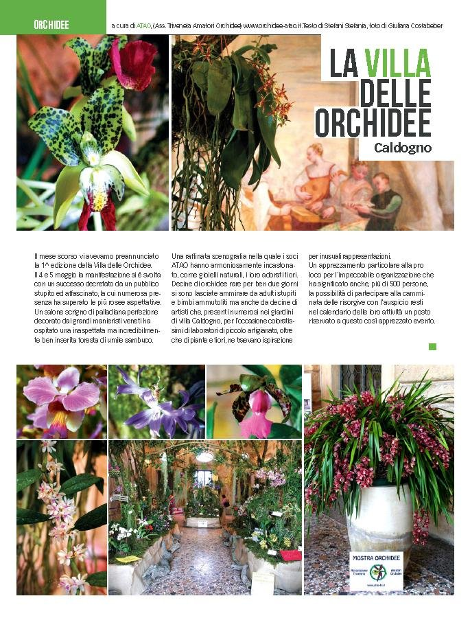

- [File stampabile-pdf](/documenti/n164-mag13.pdf)
- [File stampabile-pdf](/documenti/n165-giu13.pdf)

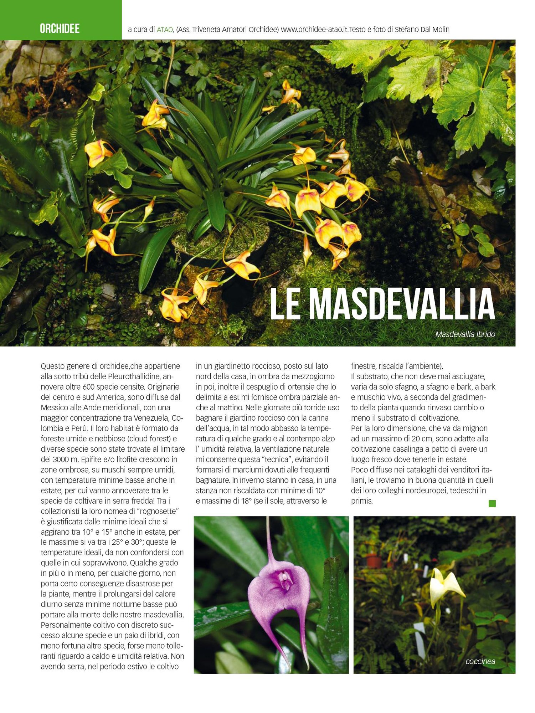

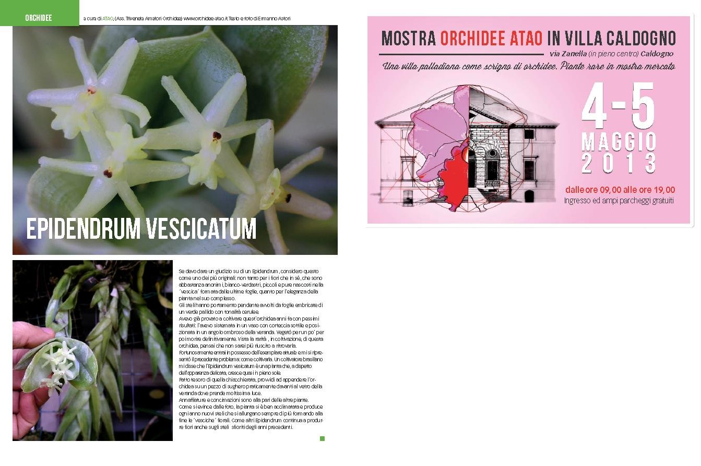

- [File stampabile-pdf](/documenti/n162-mar13.pdf)
- [File stampabile-pdf](/documenti/n163-apr13.pdf)

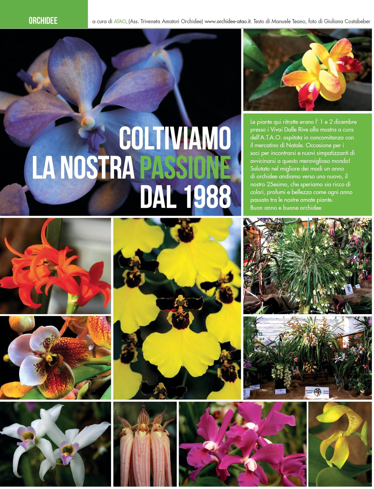

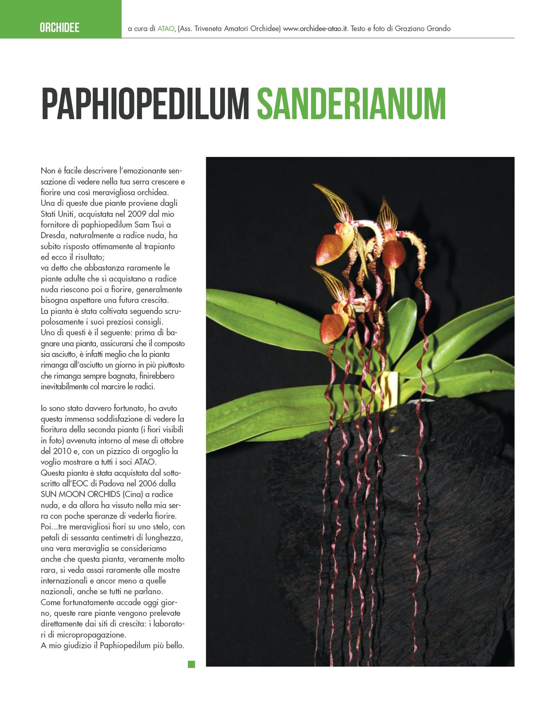

- [File stampabile-pdf](/documenti/n160-gen13.pdf)
- [File stampabile-pdf](/documenti/n161-feb13.pdf)

### Articoli pubblicati in “ViaVai” annata 2012

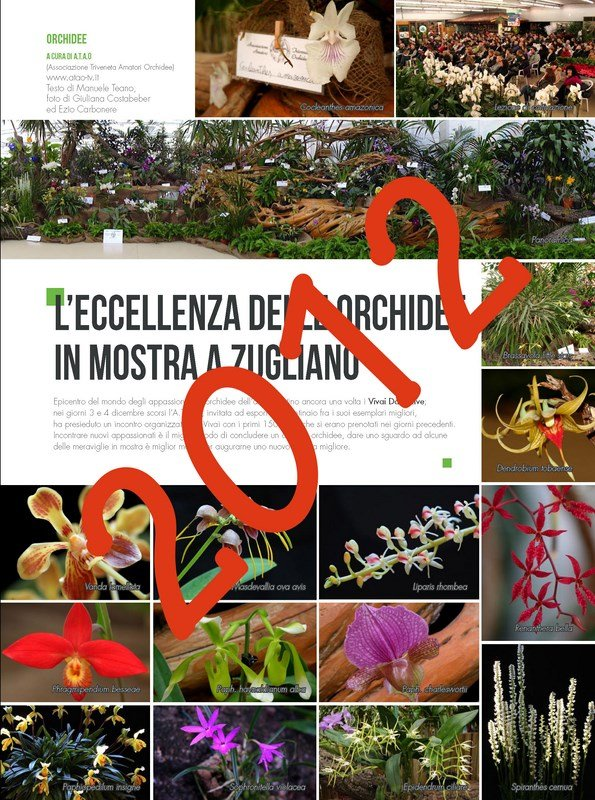

- [Gennaio 2012 (n. 147)](/documenti/n147-gen12.pdf)
- [Febbraio 2012 (n. 148)](/documenti/n148-feb12.pdf)
- [Marzo 2012 (n. 150)](/documenti/n150-mar12.pdf)
- [Maggio 2012 (n. 152)](/documenti/n152-mag12.pdf)
- [Giugno 2012 (n. 153)](/documenti/n153-giu12.pdf)
- [Luglio 2012 (n. 154)](/documenti/n154-lug12.pdf)
- [Agosto 2012 (n. 155)](/documenti/n155-ago12.pdf)
- [Settembre 2012 (n. 156)](/documenti/n156-set12.pdf)
- [Ottobre 2012 (n. 157)](/documenti/n157-ott12.pdf)
- [Novembre 2012 (n. 158)](/documenti/n158-nov12.pdf)
- [Dicembre 2012 (n. 159)](/documenti/n159-dic12.pdf)
- [Tutta l'annata 2012 in un unico file zip](/documenti/anno2012.zip)

### Articoli pubblicati in “ViaVai” annata 2011

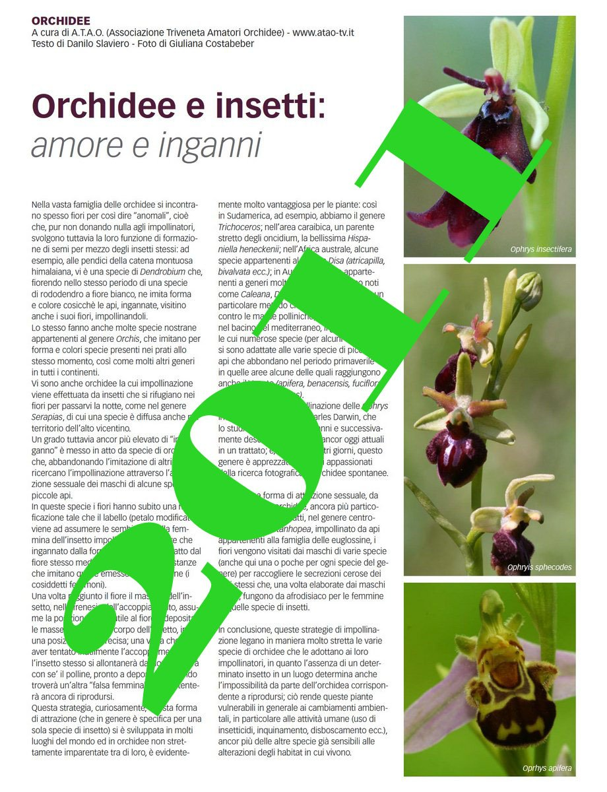

- [Gennaio 2011 (n. 135)](/documenti/n135-gen11.pdf)
- [Febbraio 2011 (n. 136)](/documenti/n136-feb11.pdf)
- [Marzo 2011 (n. 137)](/documenti/n137-mar11.pdf)
- [Aprile 2011 (n. 138)](/documenti/n138-apr11.pdf)
- [Maggio 2011 (n. 139)](/documenti/n139-mag11.pdf)
- [Giugno 2011 (n. 140)](/documenti/n140-giu11.pdf)
- [Luglio 2011 (n. 141)](/documenti/n141-lug11.pdf)
- [Agosto 2011 (n. 142)](/documenti/n142-ago11.pdf)
- [Settembre 2011 (n. 143)](/documenti/n143-set11.pdf)
- [Ottobre 2011 (n. 144)](/documenti/n144-ott11.pdf)
- [Novembre 2011 (n. 145)](/documenti/n145-nov11.pdf)
- [Dicembre 2011 (n. 146)](/documenti/n146-dic11.pdf)
- [Tutta l'annata 2011 in un unico file zip](/documenti/anno2011.zip)

### Articoli pubblicati in “ViaVai” annata 2010

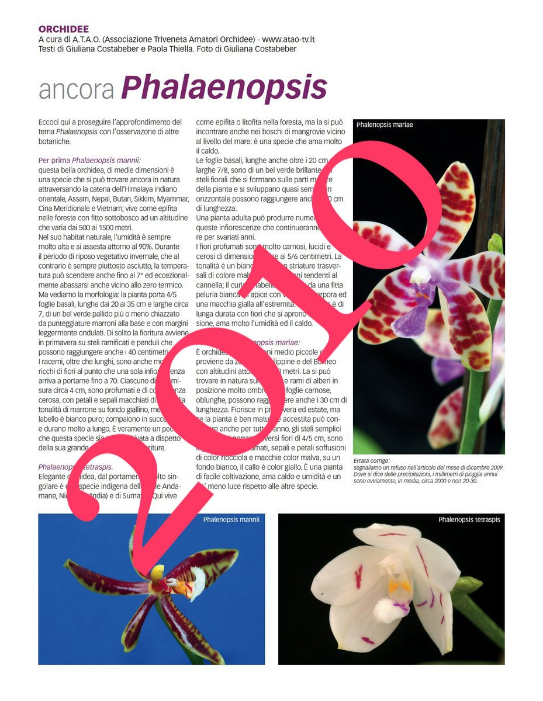

- [Febbraio 2010 (n. 124)](/documenti/n124-feb10.pdf)
- [Marzo 2010 (n. 125)](/documenti/n125-mar10.pdf)
- [Aprile 2010 (n. 126)](/documenti/n126-apr10.pdf)
- [Maggio 2010 (n. 127)](/documenti/n127-mag10.pdf)
- [Giugno 2010 (n. 128)](/documenti/n128-giu10.pdf)
- [Luglio 2010 (n. 129)](/documenti/n129-lug10.pdf)
- [Agosto 2010 (n. 130)](/documenti/n130-ago10.pdf)
- [Settembre 2010 (n. 131)](/documenti/n131-set10.pdf)
- [Ottobre 2010 (n. 132)](/documenti/n132-ott10.pdf)
- [Dicembre 2010 (n. 134)](/documenti/n134-dic10.pdf)
- [Tutta l'annata 2010 in un unico file zip](/documenti/anno2010.zip)

### Articoli pubblicati in “ViaVai” annata 2009

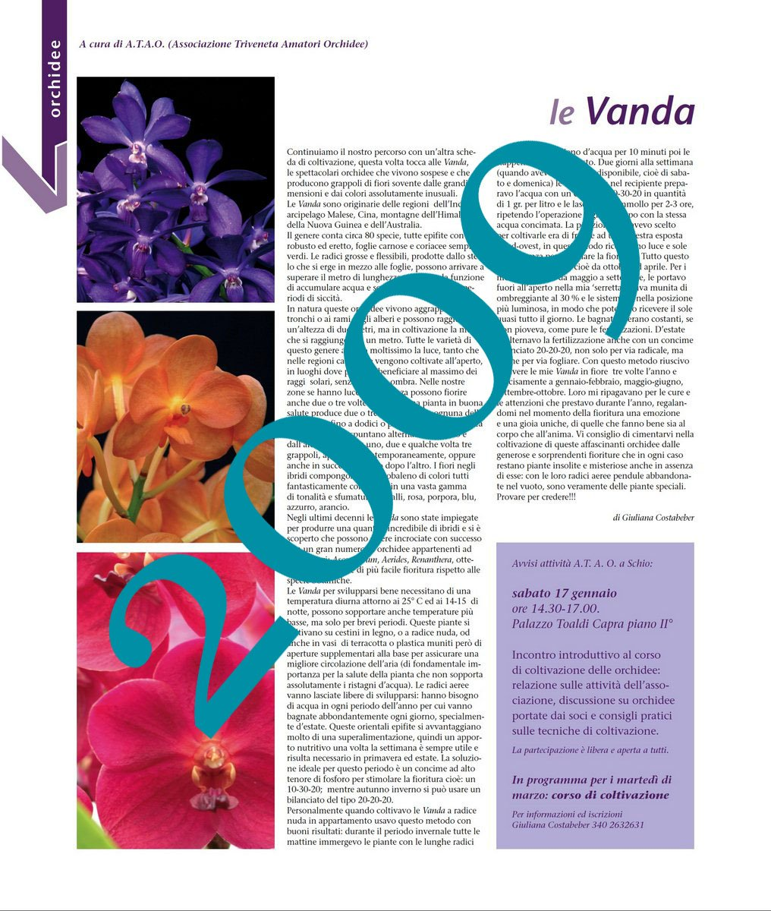

- [Gennaio 2009 (n. 111)](/documenti/n111-gen09.pdf)
- [Febbraio 2009 (n. 112)](/documenti/n112-feb09.pdf)
- [Marzo 2009 (n. 113)](/documenti/n113-mar09.pdf)
- [Aprile 2009 (n. 114)](/documenti/n114-apr09.pdf)
- [Maggio 2009 (n. 115)](/documenti/n115-mag09.pdf)
- [Giugno 2009 (n. 116)](/documenti/n116-giu09.pdf)
- [Luglio 2009 (n. 117)](/documenti/n117-lug09.pdf)
- [Agosto 2009 (n. 118)](/documenti/n118-ago09.pdf)
- [Settembre 2009 (n. 119)](/documenti/n119-set09.pdf)
- [Ottobre 2009 (n. 120)](/documenti/n120-ott09.pdf)
- [Novembre 2009 (n. 121)](/documenti/n121-nov09.pdf)
- [Dicembre 2009 (n. 122)](/documenti/n122-dic09.pdf)
- [Tutta l'annata 2009 in un unico file zip](/documenti/anno2009.zip)

### Articoli pubblicati in “ViaVai” annata 2008

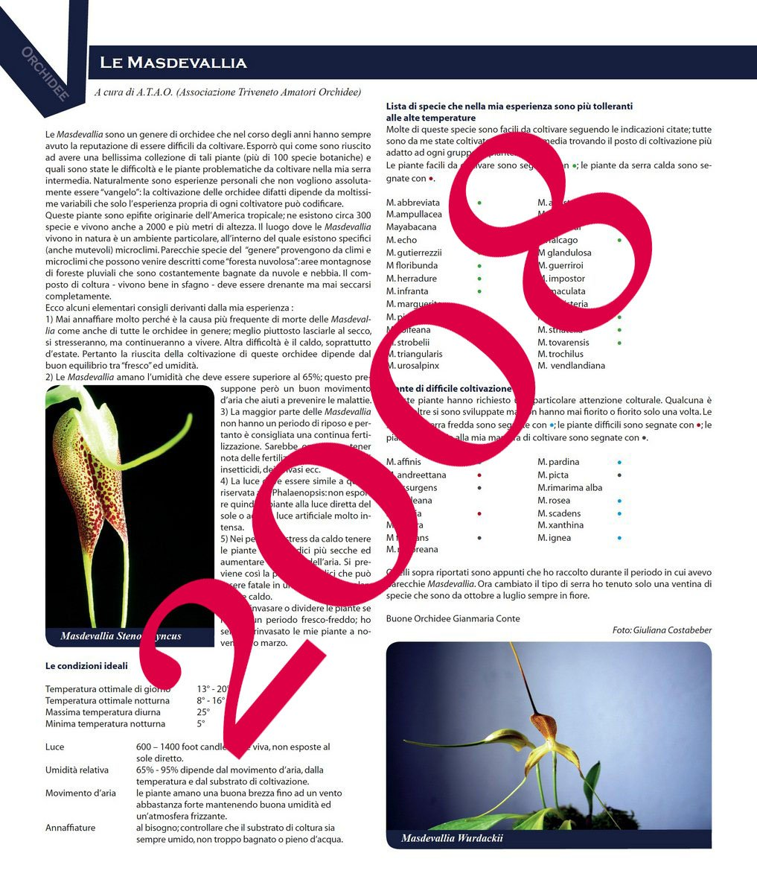

- [Maggio 2008 (n. 103)](/documenti/n103-mag08.pdf)
- [Giugno 2008 (n. 104)](/documenti/n104-giu08.pdf)
- [Luglio 2008 (n. 105)](/documenti/n105-lug08.pdf)
- [Settembre 2008 (n. 107)](/documenti/n107-set08.pdf)
- [Ottobre 2008 (n. 108)](/documenti/n108-ott08.pdf)
- [Novembre 2008 (n. 109)](/documenti/n109-nov08.pdf)
- [Dicembre 2008 (n. 110)](/documenti/n110-dic08.pdf)
- [Tutta l'annata 2008 in un unico file zip](/documenti/anno2008.zip)
