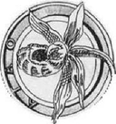
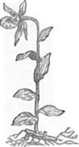

Quando quello sparuto gruppo di orchidofili, che possono esser considerati come SOCI fondatori, decisero di darsi una struttura organizzata fondando L'ATAO, pensarono anche ad un logo per questa Associazione.

Mi chiesero allora qualche bozzetto e tra essi venne scelto quello che attualmente è il simbolo della nostra Associazione. Esso si compone di due parti: l'una il disegno, l'altra la scritta. Di seguito il fiore del Cypripedium calceolus così come è raffigurato al cap. 107, pag. 359 dell'opera" HISTORIE OF PLANTS " di JOHN GERARD ( 1547-1612) pubblicata a Londra nel 1597.

Nel paragrafo ove descrive i luoghi nei quali vive il Cypripedium, Gerard cita alcune nazioni, ma non l'lnghilterra ove tuttavia esso era presente, "Però -egli aggiunge -Io nel mio giardino ne possiedo un esemplare che ho ricevuto dal mio grande amico il farmacista Garret".

Questo fa pensare che già a quei tempi esistessero amici che scambiavano tra loro delle piante e, guarda caso, proprio delle orchidee: associazioni di orchidofili ante litteram ? Forse la cosa è eccessiva, ma è simpatico pensarla.

Tornando al nostro logo, Il font dal quale è ricavata la scritta si chiama "CLEOPATRA" ed è stato prodotto da H. W. Caslon & Co. di Londra . Esso si trova nella tavola 29 del "Treasury of Authentic Art Nouveau Alphabets, Decorative Initials, Monograms, Frames and Ornaments" di Ludwig Petzendorfer, Dover Publications, Inc. , New York. 1984.

ASSOCIAZIONE TRIVENETA AMATORI ORCHIDEE

Quest'opera rappresenta l'edizione inglese, con piccole modifiche. di "Schriftenatlas Neue Folge: Eine Sammlung von Alphabeten Initlalen und Monogrammen zusammengestellt von Hofrat L. Petzendorfer" edito da Julis Hoffmann, Stuttgart, 1903.

Queste sono le fonti del nostro logo e sono assai contento che sia stato scelto a simboleggiare L'ATAO, inizialmente in un piccolo ambito territoriale ed ora nel mondo associato a quello di illustri Associazioni, vista la considerazione che l’ ATAO sta assumendo sempre più, anche al di fuori dell'ambito Triveneto.

A cura del dott. Antonio Borsato socio fondatore ATAO

